# Nodo — Modelo de dominio de Facturación y Cobros y Control de Acceso

Documento de análisis y diseño con *Domain-Driven Design*. La solución comprende los paquetes y servicios contratados, la verificación y aplicación de pagos, la emisión de facturas y las decisiones de ingreso. Los modelos conservan sus propias reglas y se coordinan mediante contratos e información identificada. La estructura desarrolla introducción, contexto, lenguaje, procesos, componentes, casos de uso y políticas operativas.

## Contenido

1. [1. Introducción](#capitulo-01)
2. [2. Contexto de Nodo, alcance y responsabilidades](#capitulo-02)
3. [3. Información adicional y lenguaje ubicuo](#capitulo-03)
4. [4. Descubrimiento de procesos y colaboración del dominio](#capitulo-04)
5. [5. *Bounded Contexts* y *Context Maps*](#capitulo-05)
6. [6. Integraciones y contratos de información](#capitulo-06)
7. [7. Modelo de dominio de Facturación y Cobros](#capitulo-07)
8. [8. Modelo de dominio de Control de Acceso](#capitulo-08)
9. [9. Componentes y responsabilidades del modelo](#capitulo-09)
10. [10. Casos de uso y coordinación de operaciones](#capitulo-10)
11. [11. Decisiones, políticas operativas y riesgos](#capitulo-11)
12. [12. Modelo integrado y anexos operativos](#capitulo-12)

---

<a id="capitulo-01"></a>

# 1. Introducción

## 1.1 Resumen

Nodo combina la prestación de servicios de coworking con el alquiler de salas y la organización de eventos. Los clientes pueden contratar un pase por día, una membresía mensual flexible, un escritorio dedicado o un plan de equipo. Cada contratación determina derechos de uso, horarios, descuentos y posibles consumos adicionales. La gestión económica debe conservar esas condiciones y convertirlas en cargos comprensibles, pagos conciliados y facturas correctamente emitidas.

El trabajo desarrolla Facturación y Cobros y Control de Acceso como dos *Bounded Contexts* relacionados. El primero administra la liquidación de servicios, las cuentas por cobrar, la verificación de pagos, las devoluciones de excesos y la emisión de facturas mediante el procedimiento externo correspondiente. El segundo administra la habilitación del miembro y las operaciones manuales sobre el registro de huella. La coordinación permite que cada modelo mantenga sus reglas sin equiparar el saldo de una cuenta con el estado físico de una cerradura.

El modelo económico se concreta en los *aggregates* CuentaPorCobrar y Factura. El modelo operativo se concreta en el *aggregate* AccesoMiembro, que contiene las operaciones de registro y baja de huella. Cada uno presenta identidad, componentes internos, invariantes, transiciones y operaciones permitidas. La especificación mantiene un enfoque de monolito modular y describe contratos de integración que pueden exponerse mediante una API sin introducir dependencias entre las entidades de ambos modelos.

## 1.2 Problema

La operación de Nodo combina información sobre planes, reservas, servicios adicionales y movimientos de dinero. Un importe informado por el cliente puede corresponder a una cuota, un depósito de evento o varios conceptos agrupados. Una captura del comprobante acredita una comunicación del cliente, pero debe contrastarse con la transacción y el abono registrados por la empresa. Sin esta conciliación, un mismo movimiento puede aplicarse dos veces o una obligación puede parecer pagada antes de que exista confirmación suficiente.

La facturación presenta además una diferencia entre liquidar servicios y emitir el comprobante definitivo. La liquidación mensual reúne cuotas y consumos, mientras las operaciones puntuales pueden exigir un depósito o un cobro anticipado. El modelo genera la factura después de verificar el pago que completa la obligación correspondiente y conserva el detalle de los conceptos cobrados. Una modificación posterior de tarifas no puede cambiar el precio que ya se comprometió para una reserva o un servicio.

El acceso introduce otra responsabilidad y otra escala temporal. Recepción debe retirar o volver a registrar manualmente una huella, por lo que aceptar la solicitud no acredita que la actuación ya ocurrió. Una interrupción puede producir incertidumbre sobre el resultado o coincidir con un pago recibido durante la actuación. El modelo debe conservar el hecho financiero y el hecho físico por separado, y ofrecer una recuperación concreta para cada combinación.

## 1.3 Preguntas de trabajo

- ¿Cómo transformar el paquete elegido, los derechos incluidos y los consumos confirmados en una obligación económica detallada y sin duplicaciones?
- ¿Cómo verificar un pago con el comprobante del cliente, la transacción externa y el abono de la empresa antes de aplicarlo?
- ¿Cómo emitir y enviar una factura por los conceptos efectivamente cobrados, manteniendo separado su estado del saldo pendiente?
- ¿Cómo gestionar un sobrepago y su devolución sin producir saldos negativos ni perder la identificación del movimiento original?
- ¿Cómo coordinar deuda, vigencia, horario y actuación sobre la huella sin declarar un resultado físico que todavía no se confirmó?
- ¿Cómo conservar las mismas reglas cuando la información llega por captura administrativa, API o mensaje de integración?

## 1.4 Objetivo general

Diseñar un modelo de dominio coherente para la facturación y el cobro de los servicios de Nodo y su coordinación con el control de acceso. El modelo debe representar tanto los cargos periódicos como las operaciones puntuales. Debe conservar el detalle del servicio contratado, la verificación de cada pago y la relación con la factura correspondiente. También debe asegurar que la suspensión y el restablecimiento describan actuaciones confirmadas sobre el registro de huella.

## 1.5 Objetivos específicos

- Delimitar las responsabilidades de Facturación y Cobros y Control de Acceso dentro del mapa de subdominios del docente.
- Representar cuotas, horas adicionales, alquileres, cancelaciones cobrables, depósitos y servicios extra mediante conceptos identificados y valorados.
- Definir los *aggregates*, sus *entities*, sus *value objects*, sus invariantes y sus *domain events*.
- Establecer el procedimiento de conciliación de pagos, aplicación de abonos, identificación de excesos y devolución verificada.
- Definir el ciclo de la factura desde su preparación después del pago hasta la confirmación de emisión y envío.
- Especificar las operaciones de huella, los permisos, las confirmaciones y la recuperación frente a concurrencia o resultado incierto.
- Describir contratos mínimos de API y mensajería que preserven las reglas del dominio y permitan observar el estado de cada operación.

## 1.6 Método de modelado

El trabajo parte de las capacidades del negocio y conserva el mapa de dominio y subdominios establecido para Nodo. Después identifica actores, conceptos económicos y decisiones de acceso, y los organiza mediante lenguaje ubicuo, *EventStorming* y *Domain Storytelling*. Las fronteras se contrastan mediante diferencias de significado, reglas, responsables y cambios de información. Los componentes internos se delimitan alrededor de las invariantes que deben mantenerse en una misma transacción.

La elaboración continúa con contratos de aplicación, estados, eventos y mecanismos de integración. Cada operación identifica el dato de entrada, la condición de aceptación, el cambio permitido y la respuesta ante un resultado incierto. Los ejemplos numéricos se utilizan para explicar cómo se conserva el total, cómo se aplica un pago y cuándo corresponde una factura. Las decisiones operativas asumidas se concentran en matrices y se mantienen consistentes con las operaciones, los diagramas y el pseudocódigo.

## 1.7 Alcance y límites

El alcance económico comprende todos los cargos que correspondan a los servicios contratados por los clientes. Incluye membresías, paquetes, horas de sala no cubiertas, alquileres puntuales, cancelaciones cobrables, depósitos de eventos y servicios adicionales. Las reglas de disponibilidad, aforo, aprobación del evento y cálculo de precios permanecen en los subdominios responsables, que entregan hechos e importes identificados a Facturación y Cobros. El modelo económico conserva las condiciones utilizadas y no vuelve a calcular una reserva histórica con una tarifa nueva.

El alcance de Control de Acceso comprende el permiso del miembro, su vigencia, las restricciones horarias y las operaciones sobre el registro de huella. Los accesos temporales de eventos se integran mediante derechos explícitos del subdominio Agenda de eventos. El modelo no almacena imágenes, plantillas ni características biométricas. La conexión con un dispositivo concreto y la operación del servicio tributario se encapsulan detrás de adaptadores, sin implementar esas integraciones en esta documentación.

---

<a id="capitulo-02"></a>

# 2. Contexto de Nodo, alcance y responsabilidades

## 2.1 Negocio, paquetes y servicios

Nodo obtiene ingresos de las membresías, el alquiler de salas y la contratación de eventos. Su oferta comprende pase por día, mensual flexible, escritorio dedicado y plan de equipo. Los paquetes pueden incluir horas de sala, descuentos y acceso en horario normal o continuo. La elección del paquete modifica los conceptos económicos y los derechos que deben intercambiar los subdominios, aunque no cambia la identidad del cliente.

Los consumos adicionales deben conservar un detalle que permita explicar qué se cobra y por qué. Las horas de sala que exceden las incluidas se cobran con las condiciones del plan y el precio comprometido para el servicio. Las cancelaciones de sala realizadas con menos de cuatro horas de anticipación generan el cargo de la franja completa, mientras las anteriores al límite no generan penalidad. Los eventos incorporan depósito anticipado, alquiler del salón y servicios extra como catering o equipo audiovisual.

| Servicio o paquete | Información económica recibida | Tratamiento en Facturación y Cobros | Relación con Control de Acceso |
| --- | --- | --- | --- |
| Pase por día | Fecha, precio y recursos incluidos | Cuenta por el pase; extras como conceptos separados | Derecho limitado a fecha y horario concedidos |
| Mensual flexible | Ciclo, cuota, horas incluidas y descuento | Liquidación de cuota y consumos adicionales del período | Vigencia mensual y horario del plan |
| Escritorio dedicado | Puesto asignado, período y cuota | Cargo periódico identificado; servicios adicionales detallados | Derecho asociado a la membresía, sin asignar puestos desde Acceso |
| Plan de equipo | Titular pagador, miembros cubiertos, cuota y condiciones | Cuenta del titular y detalle de cargos; evitar facturar el mismo consumo a dos sujetos | Derechos individuales vinculados al plan y pagador correspondiente |
| Alquiler puntual de sala | Reserva, franja, precio y descuento comprometidos | Cargo del servicio o cancelación tardía; identidad del origen conservada | Derecho temporal si la contratación lo concede |
| Horas adicionales | Consumo que excede el derecho incluido y precio aplicable | Concepto diferenciado de horas extra; no recobrar las incluidas | El consumo no cambia por sí mismo el estado de la huella |
| Evento y depósito | Evento aprobado, importe total y depósito exigido | Cuenta del depósito y cuenta del saldo restante, sin duplicar el total | Derecho temporal confirmado por Agenda de eventos |
| Servicios extra de evento | Catering, audiovisual y otras líneas autorizadas | Descripción, cantidad, precio y autorización en cada concepto | No genera un derecho de ingreso independiente salvo instrucción del evento |

## 2.2 Subdominios y flujo de datos

El dominio de Nodo comprende la gestión de espacios, personas y eventos. El mapa mantiene exclusivamente los ocho subdominios y la clasificación del docente. Las flechas siguientes representan intercambios de información y no una relación jerárquica entre componentes. La vista destaca cómo Facturación y Cobros transforma servicios valorizados en obligaciones, y cómo Control de Acceso utiliza derechos y situación económica para decidir una actuación.

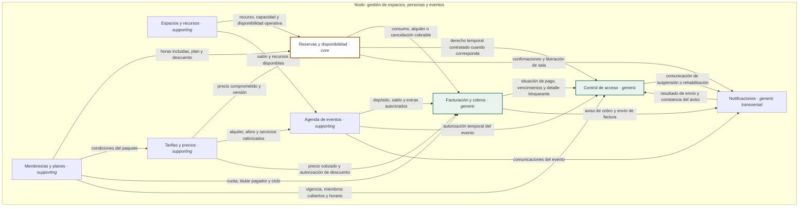

| Subdominio | Clasificación | Responsabilidad y dato principal |
| --- | --- | --- |
| Reservas y disponibilidad | *Core* | Evitar solapes, mantener disponibilidad y comunicar reservas, consumos y cancelaciones |
| Membresías y planes | *Supporting* | Definir paquete, derechos, cuota, titular pagador, miembros cubiertos y vigencia |
| Agenda de eventos | *Supporting* | Gestionar aprobación, depósito requerido, contratación de extras y derechos temporales |
| Tarifas y precios | *Supporting* | Proporcionar precios y descuentos con vigencia y versión |
| Espacios y recursos | *Supporting* | Mantener recursos, capacidades y características operativas |
| Facturación y cobros | *Generic* | Liquidar cargos, conciliar pagos, devolver excesos y emitir facturas |
| Control de acceso | *Generic* | Evaluar ingreso y coordinar operaciones confirmadas sobre la huella |
| Notificaciones | *Generic* transversal | Entregar mensajes y devolver resultados de envío correlacionados |

Reservas y disponibilidad conserva la responsabilidad de impedir reservas solapadas y respetar los quince minutos de limpieza. Facturación y Cobros recibe el resultado económico de una reserva o cancelación, sin decidir disponibilidad. Control de Acceso recibe derechos y obligaciones, sin calcular tarifas ni editar el plan. Notificaciones entrega mensajes, pero la obligación de avisar antes de una suspensión sigue perteneciendo a la política de acceso.

## 2.3 Alcance económico y operativo

La cuenta mensual consolida conceptos de un mismo pagador, moneda y período de liquidación. Los servicios puntuales pueden producir cuentas independientes cuando su cobro debe ocurrir antes del consumo o fuera del ciclo mensual. El depósito de un evento se identifica como un tramo del importe contratado, y el cargo final incluye únicamente el remanente y los extras que no se cobraron antes. La factura de cada tramo conserva la relación con el evento y permite reconstruir el total cobrado sin duplicarlo.

El acceso se evalúa respecto del sujeto que solicita ingresar y del pagador que cubre su derecho. En un plan de equipo, la deuda pertenece al titular y la afectación del acceso debe identificar explícitamente a los miembros cubiertos. Un visitante de un evento no se convierte en miembro para utilizar el mismo proceso de renovación. Los derechos temporales se consultan por su identidad y período, mientras AccesoMiembro mantiene el ciclo de los miembros habituales.

## 2.4 Responsabilidades y procedimiento administrativo

Administración se entiende como una función operativa que desempeña Recepción. La misma persona puede revisar cuentas, registrar movimientos, conciliar el abono y realizar la emisión de la factura. El sistema registra cada actuación con su permiso, fecha, motivo y referencia documental, aunque coincidan el usuario físico y el puesto. Dirección conserva las decisiones de autorización que cambian precios excepcionales, devolución de excesos y políticas de acceso.

| Función | Responsable operativo | Procedimiento asumido | Registro obligatorio |
| --- | --- | --- | --- |
| Administración de cargos | Recepción en función administrativa | Recibir conceptos de los servicios; comprobar titular, período, moneda, precio y ausencia de duplicados; cerrar la liquidación | Cuenta, conceptos, precio comprometido y autorizaciones |
| Verificación y conciliación de pago | Recepción en función administrativa | Recibir comprobante; consultar transacción externa; comparar monto, moneda, titular y abono en el registro de la empresa | Referencia externa, transacción, abono, comprobante y fecha de verificación |
| Dirección | Dirección | Aprobar descuentos especiales, devolución de excesos y excepciones operativas documentadas; establecer permisos de rehabilitación | Autorización identificada, alcance, vigencia y motivo |
| Responsable de emisión | Recepción | Preparar Factura cuando se completa el pago verificado; emitir mediante el mecanismo tributario externo; registrar resultado y enviar | Factura interna, referencia fiscal, detalle cobrado y constancia de envío |
| Operación de huella | Recepción | Adquirir una única tarea; dar de baja o registrar huella; confirmar resultado real; informar incertidumbre sin duplicar actuación | Operación, intento, ejecutor, dispositivo y evidencia mínima |
| Cliente o titular pagador | Cliente | Seleccionar paquete, contratar servicios, efectuar pago y comunicar comprobante | Identidad del pago comunicado y obligaciones a las que corresponde |

El procedimiento comienza con la identificación de los servicios que originan el cargo. Recepción comprueba que los conceptos están autorizados y registra la cuenta con su vencimiento. Cuando el cliente comunica un pago, Recepción utiliza el servicio externo de verificación y el registro de abonos para decidir si puede aplicarse. Si la obligación queda saldada, la misma persona prepara la factura, confirma su emisión y registra el envío al cliente.

## 2.5 Límites del modelo

Los dos *Bounded Contexts* desarrollados conservan sus propias entidades y transacciones. Facturación y Cobros no altera reservas, aforo o vigencia de membresía para corregir una diferencia de saldo. Control de Acceso no utiliza el repositorio de cuentas ni toma el comprobante del cliente como autorización suficiente. La emisión fiscal y la actuación sobre la huella permanecen como efectos externos que requieren resultado verificable.

- Las horas incluidas y los descuentos llegan valorizados desde los responsables del plan y del precio.
- La aprobación de un evento y la validez de sus derechos temporales permanecen en Agenda de eventos.
- El lector de huella no se representa mediante plantillas biométricas dentro del modelo.
- El detalle tributario definitivo y la numeración fiscal se obtienen del mecanismo de emisión autorizado.
- Los cargos adicionales siempre indican servicio, origen, cantidad, precio y razón del cobro.

---

<a id="capitulo-03"></a>

# 3. Información adicional y lenguaje ubicuo

## 3.1 Información adicional de la operación

La información operativa complementa la descripción de paquetes, reservas y servicios de Nodo. Permite precisar cómo se verifican pagos y cómo Recepción realiza las actuaciones sobre la cerradura. La función administrativa y la responsabilidad de emisión pueden recaer en la misma persona, mientras Dirección conserva las autorizaciones especiales. Estas condiciones se incorporan al modelo como un procedimiento definido y no como una lista de preguntas sin respuesta.

| Aspecto | Información operativa adoptada | Consecuencia para el modelo |
| --- | --- | --- |
| Contratación | Cada paquete identifica derechos, titular pagador, vigencia y condiciones económicas | Los conceptos conservan paquete y precio aplicable; no se cobra una hora incluida como extra |
| Pago informado | El cliente comunica comprobante y referencia | Se registra la comunicación, pero todavía no se modifica el saldo |
| Pago verificado | Se comprueban transacción externa y abono en la empresa | Solo la evidencia conciliada permite aplicar el movimiento |
| Exceso pagado | Se devuelve el importe que supera la obligación, después de verificarlo y autorizarlo | Exceso y devolución quedan separados del saldo y del total facturado |
| Factura | Se prepara cuando el pago completa la obligación; Recepción confirma emisión externa y envío | Factura pertenece a Facturación y Cobros y tiene identidad y estado propios |
| Impago | El modelo aplica cinco días calendario desde vencimiento y aviso con al menos veinticuatro horas de anticipación | La fecha de corte requiere ambas condiciones y se calcula por obligación bloqueante |
| Horario | Horario normal asumido de lunes a viernes de 08:00 a 18:00; otros planes pueden conceder acceso continuo | El derecho del plan se evalúa por instante y no mediante una etiqueta genérica de miembro activo |
| Huella | Recepción da de baja y vuelve a registrar manualmente el registro de la cerradura | Solicitud y confirmación son operaciones distintas |
| Rehabilitación | Recepción tiene permiso ordinario bajo la política aprobada por Dirección | Se exige regularización, derecho vigente y resultado físico confirmado |

## 3.2 Lenguaje de Facturación y Cobros

Los términos económicos describen obligaciones, movimientos y documentos diferentes. Una cuenta identifica lo que debe pagarse, mientras un pago identifica el dinero que efectivamente ingresó. La factura documenta los conceptos cobrados y conserva su propia relación con la emisión externa. Esta separación permite explicar pagos parciales, excesos y reenvíos sin alterar retrospectivamente el importe contratado.

| Término | Significado y ejemplo | Qué no representa | Regla asociada | Evento relacionado |
| --- | --- | --- | --- | --- |
| CuentaPorCobrar | Obligación de un pagador con conceptos, vencimiento y saldo | Factura fiscal ni membresía completa | Saldo no negativo y conceptos identificados | CuentaPorCobrarCreada |
| ConceptoCobro | Valor inmutable de un servicio: cuota, hora extra, alquiler, depósito o cargo por cancelación | Reserva completa o precio vigente recalculado | Origen único y precio comprometido conservado | CuentaPorCobrarCreada |
| Dinero | Monto decimal exacto y moneda | Número sin moneda ni tipo de cambio implícito | Operaciones de la misma moneda | PagoRegistrado |
| PagoInformado | Comprobante y referencia comunicados por el cliente | Confirmación del abono | No modifica saldo | PagoInformadoRegistrado |
| PagoVerificado | Transacción y abono conciliados con la obligación | Captura aislada o autorización bancaria sin abono | Identidad, monto y moneda deben coincidir | PagoVerificadoRegistrado |
| AplicacionPago | Parte del movimiento verificado que reduce el saldo de una cuenta | Nuevo cargo bancario o copia de la factura | Referencia aplicada una sola vez | PagoRegistrado |
| ExcesoPago | Parte verificada del movimiento que supera el saldo | Saldo negativo ni descuento | Se conserva como devolución pendiente | ExcesoPagoIdentificado |
| DevolucionExceso | Entidad interna que conserva autorización, importe y resultado de devolución | Segundo pago de la cuenta | No devolver más del exceso pendiente | DevolucionConfirmada |
| Factura | Documento interno de conceptos cobrados y relación con comprobante fiscal | Cuenta pendiente ni simple archivo adjunto | Total coincide con conceptos y pago aplicado | FacturaPreparada y FacturaEmitida |
| LineaFactura | Copia inmutable de descripción, cantidad e importe cobrados | Consulta dinámica de la tarifa actual | Total de factura igual a suma de líneas | FacturaPreparada |
| Pendiente | Estado de cuenta con saldo positivo | Estado de factura | Equivalencia entre estado y saldo | CuentaPorCobrarCreada |
| Saldada | Estado de cuenta con saldo cero | Miembro sin cualquier deuda ni acceso habilitado | Solo pagos verificados reducen el saldo | CuentaSaldada |
| PendienteDeEmision | Factura preparada, emisión externa por confirmar | Pago pendiente | Cuenta saldada y datos fiscales completos | FacturaPreparada |
| Emitida | Factura con referencia fiscal confirmada | Factura enviada al cliente | Resultado externo verificado | FacturaEmitida |
| Enviada | Factura emitida con constancia de envío | Lectura confirmada del destinatario | Envío acreditado sin segunda emisión | FacturaEnviada |

## 3.3 Lenguaje de Control de Acceso

Los nombres técnicos se escriben de forma uniforme y expresan conceptos del negocio. AccesoMiembro conserva la identidad del permiso y el último resultado operativo confirmado. OperacionRegistroHuella identifica una actuación concreta, sus intentos y el responsable que puede ejecutarla. La observación física y la evaluación de elegibilidad complementan el estado para evitar que una palabra como habilitado o suspendido oculte una incertidumbre de la cerradura.

| Término | Significado y ejemplo | Qué no representa | Regla asociada | Evento relacionado |
| --- | --- | --- | --- | --- |
| AccesoMiembro | Permiso identificado de ingreso de un miembro | Cuenta, plan completo ni dato biométrico | Cambios mediante su raíz | Eventos de acceso |
| Habilitado | Registro disponible y derecho operativo reconocido | Ingreso irrestricto a cualquier hora | Cada entrada evalúa horario y vigencia | AccesoRestablecido |
| SuspensionPendiente | Solicitud aceptada, baja todavía no confirmada | Registro ausente acreditado | No declarar suspensión por aceptar la tarea | SuspensionSolicitada |
| Suspendido | Baja confirmada o ausencia verificada mediante inspección | Membresía cancelada | Resultado físico acreditado | AccesoSuspendido |
| RestablecimientoPendiente | Alta en proceso o corrección de un alta que perdió elegibilidad | Ingreso ya permitido | Alta real y elegibilidad actual antes de habilitar | RestablecimientoSolicitado |
| SituacionPago | Valor traducido de obligaciones, saldo exigible y vencimientos del pagador que cubre el derecho | CuentaPorCobrar compartida entre contextos | Alcance completo y sujeto correctos | Reacción a CuentaSaldada |
| ConstanciaAviso | Resultado exitoso de aviso identificado por pagador y obligaciones | Solicitud de envío o mensaje fallido | Margen previo al corte | ResultadoEnvio |
| PeriodoTolerancia | Cinco días calendario desde vencimiento | Condonación ni extensión del vencimiento | Evaluación por obligación bloqueante | Evaluación de suspensión |
| OperacionRegistroHuella | Entidad interna de alta, baja por impago o baja correctiva | *Value object* sin identidad ni plantilla de huella | Un ejecutor adquirido por intento | Hechos finales de acceso |
| ObservacionRegistroHuella | Presente, Ausente o Desconocida, con fecha y evidencia | Garantía de ausencia de avería | No declarar un resultado actual por mensaje antiguo | Confirmación o reconciliación |
| EvaluacionAcceso | Resultado identificado para Suspender, Restablecer o Ingresar | Booleano aportado por el cliente | Contexto, versión y acción coherentes | Referencia de la decisión tomada |
| IncidenciaAcceso | Desviación operativa que requiere atención | Deuda nueva o permiso automático | Incertidumbre bloquea nuevas actuaciones incompatibles | Registro de incidencia |

## 3.4 Significados compartidos entre subdominios

Un término cotidiano puede intervenir en ambos modelos sin significar lo mismo. La información económica se traduce a una situación de pago y no se transporta como una entidad compartida. La autorización de ingreso tampoco modifica el detalle de un cargo o el estado fiscal de una factura. Las expresiones siguientes se mantienen contextualizadas para que las conversaciones administrativas y las operaciones del sistema utilicen el mismo significado.

| Término | Facturación y Cobros | Control de Acceso | Uso acordado |
| --- | --- | --- | --- |
| AlDia | No existen obligaciones vencidas pendientes dentro del alcance consultado | Condición económica que se combina con vigencia y horario | Identificar pagador, obligaciones e instante |
| Confirmado | Transacción y abono verificados o emisión fiscal acreditada, según objeto | Alta o baja de huella efectivamente acreditada | Nombrar el hecho y la evidencia correspondiente |
| Vigente | Precio o condición contractual aplicable al servicio | Derecho del plan válido en el instante solicitado | Evitar usar la vigencia del plan como sustituto del saldo |
| Regularizado | Obligaciones exigibles cubiertas por aplicaciones de pago verificadas | Insumo que permite evaluar restablecimiento | No asumir que el pago modifica directamente la cerradura |
| Cliente | Titular pagador y receptor de factura | Miembro o sujeto de un derecho temporal identificado | Distinguir pagador de beneficiario del derecho |
| Deposito | Anticipo identificado como tramo económico de un evento | Dato que Agenda de eventos utiliza para confirmar un derecho temporal | No registrar el mismo tramo otra vez en el saldo final |

## 3.5 Nombres de operaciones y componentes

Los comandos expresan acciones y los eventos expresan hechos en pasado. RegistrarPagoConfirmado solicita una aplicación, mientras PagoRegistrado afirma que la aplicación fue aceptada y guardada. SolicitarRestablecimiento inicia una operación, mientras AccesoRestablecido acredita que el alta fue confirmada y la elegibilidad seguía siendo válida. Esta diferencia se mantiene en los *Application Services*, las APIs y los mensajes para evitar que un nombre anuncie un resultado antes de que ocurra.

- *Aggregate*, *aggregate root*, *entity* y *value object* conservan la terminología del modelado de dominio.
- *Domain Service*, *Application Service*, *Repository* y *Factory* identifican responsabilidades diferentes.
- *Bounded Context*, *Context Map*, *EventStorming* y *Domain Storytelling* se utilizan como términos del curso.
- Los identificadores de estados usan Pendiente, Saldada, Habilitado y SuspensionPendiente, sin variantes simultáneas con barras bajas.

---

<a id="capitulo-04"></a>

# 4. Descubrimiento de procesos y colaboración del dominio

## 4.1 Procesos completos de contratación, cobro y acceso

El proceso económico comienza con la selección del paquete o la contratación de un servicio. Los subdominios responsables confirman el origen y el precio de cada cargo antes de incorporarlo a la liquidación. Después se verifica el movimiento comunicado por el cliente, se aplica el dinero y se prepara la factura cuando se completa el importe de la cuenta. El proceso de acceso reacciona a derechos y obligaciones, y mantiene separadas las decisiones económicas de las actuaciones físicas.

La descripción utiliza *EventStorming* para distinguir actor, comando, evento, información consultada, regla, política, sistema externo y punto de atención. Los comandos pueden rechazarse y los eventos describen hechos aceptados que ya se guardaron. Una política conecta un hecho con una acción posterior, pero no garantiza que el efecto externo haya ocurrido. Los puntos de atención identifican discrepancias concretas que deben llevar a revisión administrativa, sin sustituir las reglas definidas.

## 4.2 Facturación de servicios, verificación y emisión

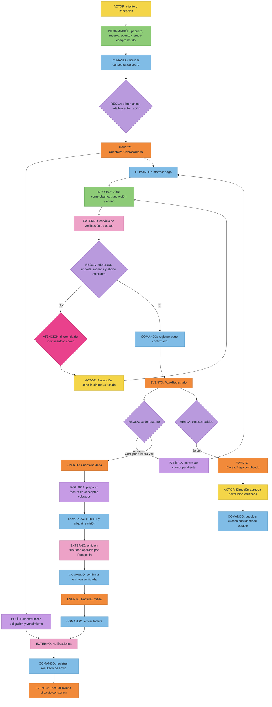

La cuenta admite cargos de todos los servicios del alcance y no depende de que el origen sea una renovación. La verificación compara el comprobante comunicado con el movimiento externo y el abono de la empresa. La parte que excede la obligación conserva un expediente de devolución y no aumenta el total facturado. Una respuesta fiscal incierta impide confirmar la emisión y exige consultar el resultado antes de repetir la actuación.

## 4.3 Impago, operación de huella y regularización

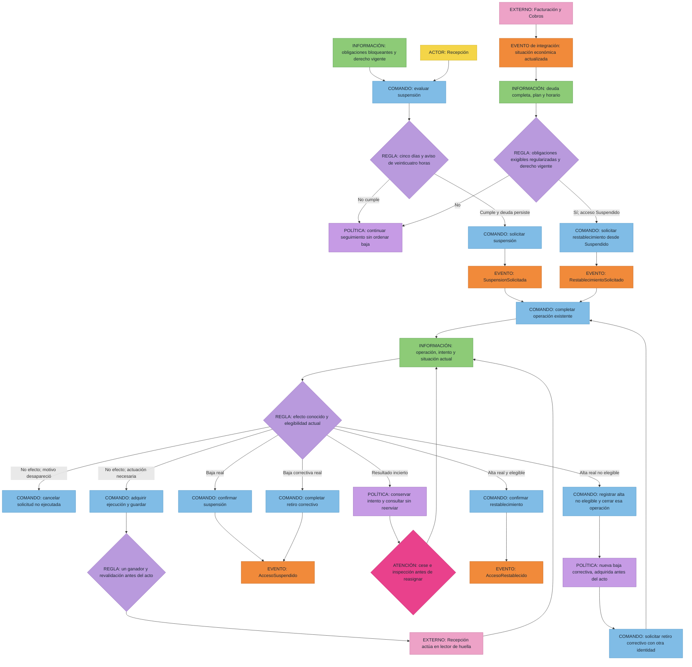

Las operaciones pendientes se completan utilizando la misma identidad y no vuelven a solicitarse desde un estado incompatible. La adquisición se guarda antes de entregar la tarea y solo el ganador puede actuar. Cuando el resultado es incierto, la consulta y la inspección sustituyen al reenvío automático. Si el alta ya ocurrió y se perdió elegibilidad, el sistema conserva ese hecho, cierra el alta y crea otra operación para la baja correctiva.

## 4.4 *Domain Storytelling* de la operación administrativa

La historia inicial muestra cómo se relacionan el cliente, Recepción y los servicios contratados. Su interés es identificar qué información cambia de responsable y qué decisión corresponde a cada función. La misma persona de Recepción puede desempeñar la función administrativa y la de emisión, pero el registro conserva ambas actuaciones. El modelo distingue documentos y movimientos para que esa concentración de funciones no elimine la trazabilidad.

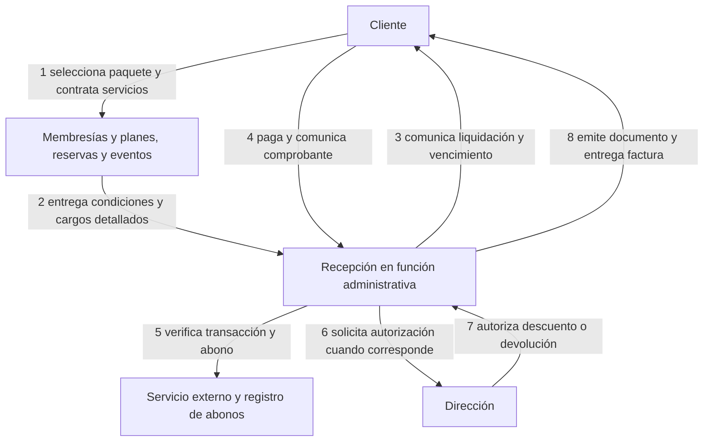

La historia de coordinación agrega el estado explícito de cada modelo. Facturación y Cobros aplica los pagos sin escribir el estado de la huella. Control de Acceso obtiene una situación económica traducida y conserva sus propios derechos y operaciones. La actuación manual se acredita antes de anunciar suspensión o rehabilitación, y el envío al cliente se registra por separado.

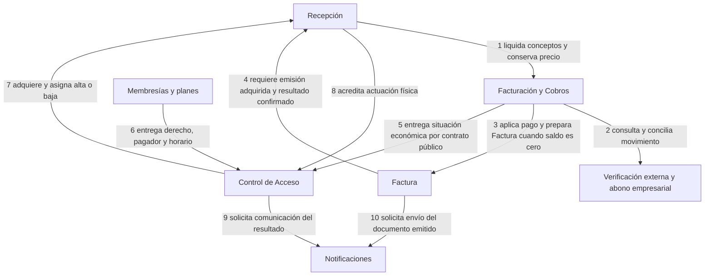

## 4.5 Variaciones del proceso

| Situación | Respuesta de negocio | Información conservada |
| --- | --- | --- |
| Paquete incluye horas de sala | Cobrar únicamente el excedente valorizado | Derecho incluido, consumo y precio comprometido |
| Cancelación a tres horas | Cargar la franja completa comunicada por Reservas y disponibilidad | Reserva, cancelación e importe |
| Pago parcial | Reducir saldo y conservar cuenta Pendiente | Movimiento, importe aplicado y saldo restante |
| Sobrepago | Aplicar saldo restante y devolver exceso verificado con autorización | Importe recibido, aplicado, exceso y devolución |
| Servicio cobrado dos veces por mensaje repetido | Reconocer origen de cargo y evitar otra cuenta | Clave de origen y resultado original |
| Movimiento bancario duplicado real | Conservar ambos movimientos y tramitar el exceso | Referencias distintas y expediente de devolución |
| Pago durante baja de huella | Confirmar baja real y evaluar rehabilitación aparte | Tiempos, evidencia y causalidad |
| Resultado fiscal o físico incierto | Consultar antes de repetir la actuación | Intento, ejecutor y resultado conocido |

---

<a id="capitulo-05"></a>

# 5. *Bounded Contexts* y *Context Maps*

## 5.1 Fronteras de los modelos

Facturación y Cobros y Control de Acceso representan dos *Bounded Contexts* con lenguaje y reglas propios. El primero protege obligaciones, movimientos de dinero, devoluciones y documentos cobrados. El segundo protege derechos de ingreso, restricciones horarias y actuaciones sobre la huella. La coordinación se apoya en contratos de información y no en compartir las entidades de ambos modelos.

| Señal de frontera | Facturación y Cobros | Control de Acceso | Consecuencia |
| --- | --- | --- | --- |
| Significado | Cuenta saldada y factura emitida | Acceso habilitado y baja confirmada | El mismo término confirmado debe indicar su objeto |
| Reglas | Moneda, saldo, referencia y total facturado | Vigencia, horario, aviso y resultado físico | Cada raíz protege invariantes de su modelo |
| Responsabilidad | Recepción administra y emite; Dirección autoriza excepciones económicas | Recepción configura huella bajo política de Dirección | Un usuario puede desempeñar funciones distintas sin fusionar los modelos |
| Cambio de proceso | Se completa el pago y se prepara el documento | Se reevalúa el derecho y se completa una operación física | Los eventos coordinan transacciones separadas |
| Recuperación | Conciliar abono, evitar otra aplicación o devolución | Consultar ejecutor, cesar autorización e inspeccionar | El tratamiento de incertidumbre conserva el significado del efecto |

Un único contexto con varias raíces sería técnicamente posible. La elección de dos contextos se justifica por las diferencias de significado y responsabilidad, no por la necesidad de utilizar dos servidores. El monolito modular permite mantener ambos modelos en una aplicación y separar sus interfaces y persistencia lógica. Las llamadas al proveedor de pagos, al mecanismo fiscal y al lector permanecen fuera de la transacción local de cada raíz.

## 5.2 *Context Map* general

La vista general ubica los dos modelos dentro de las capacidades de Nodo. Mantiene los nombres de los ocho subdominios del docente y muestra externos operativos con borde diferenciado. Sus líneas indican relación y no expresan un contrato de dependencia direccional. El flujo de datos completo se desarrolla en §2.2 y los patrones de integración se concretan en el capítulo siguiente.

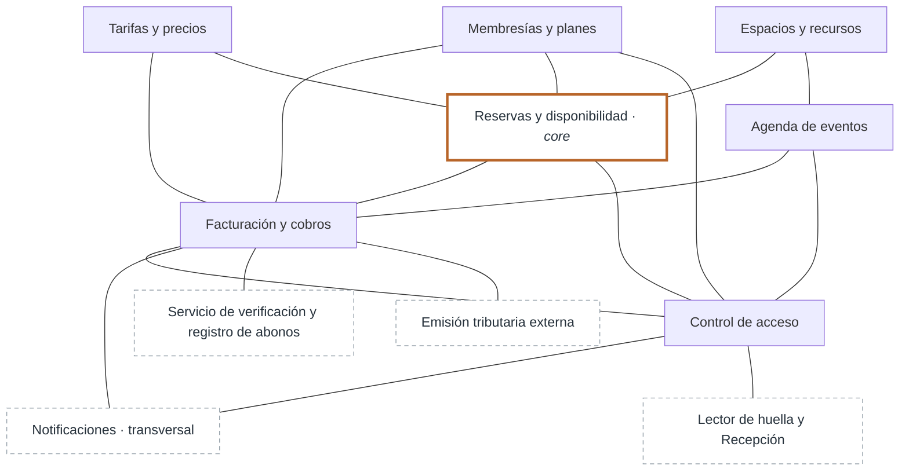

## 5.3 Modelo interno de cada *Bounded Context*

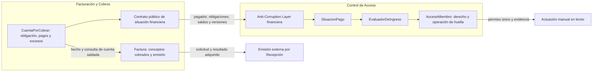

La cuenta y la factura son raíces distintas dentro de Facturación y Cobros. El evento de cuenta saldada provoca una consulta de los conceptos cerrados y permite preparar la factura sin compartir una instancia mutable de la cuenta. La *Anti-Corruption Layer* pertenece a Control de Acceso y convierte la respuesta pública en SituacionPago. AccesoMiembro utiliza ese valor para decidir, mientras el estado de Factura no se interpreta como sustituto de la confirmación del abono.

## 5.4 Distribución de responsabilidades internas

La selección de raíces responde a las reglas que necesitan modificarse juntas. CuentaPorCobrar agrupa saldo, aplicaciones y excesos porque deben conservar la igualdad entre movimiento recibido, importe aplicado y devolución pendiente. Factura agrupa sus líneas y resultado fiscal porque una emisión aceptada debe mantener un documento coherente e inmutable. AccesoMiembro agrupa estado, operación y evidencia porque una confirmación física debe cerrar el intento correspondiente y actualizar el permiso en la misma transacción.

- La verificación externa de pagos se realiza antes de aplicar el movimiento a CuentaPorCobrar.
- La emisión externa se realiza después de preparar Factura y adquirir un intento de emisión.
- La ejecución sobre la huella se realiza después de adquirir y guardar el permiso del operador.
- La persistencia de una raíz no concede permiso para modificar directamente otra raíz o el servicio externo.

## 5.5 Vecinos y límites de integración

Membresías y planes entrega la cuota, los derechos y el pagador que cubre cada miembro. Reservas y disponibilidad entrega el consumo, la cancelación cobrable y el precio que ya se comprometió para la reserva. Agenda de eventos entrega los tramos económicos, los servicios adicionales y los derechos temporales. Tarifas y precios entrega cotizaciones y autorizaciones identificadas, mientras Espacios y recursos participa a través de la contratación responsable y no mediante cargos inventados por Facturación.

Los derechos temporales no se convierten en una renovación de miembro. Se consultan mediante un contrato que identifica sujeto, origen, intervalo y condiciones económicas cumplidas. Control de Acceso puede evaluar su validez sin almacenar asistentes, aforo o detalles de organización del evento. De esta manera se integra el ingreso temporal sin ampliar el alcance hacia el modelo interno de los otros subdominios.

---

<a id="capitulo-06"></a>

# 6. Integraciones y contratos de información

## 6.1 Gobierno de los contratos

La integración distingue quién controla el modelo y quién solicita una operación. Un proveedor puede definir el contrato aunque las peticiones viajen desde el consumidor hacia él. Esta diferencia es relevante en Notificaciones, que publica el servicio de entrega mientras Facturación y Cobros y Control de Acceso lo consumen. El sentido de una llamada HTTP no se utiliza como sustituto de la relación entre modelos.

| Relación | Proveedor del modelo | Consumidor | Patrón elegido y responsabilidad |
| --- | --- | --- | --- |
| Paquetes y derechos | Membresías y planes | Facturación y Cobros; Control de Acceso | *Customer/Supplier* con datos mínimos de cuota, pagador, vigencia y restricciones |
| Consumos y cancelaciones | Reservas y disponibilidad | Facturación y Cobros | *Customer/Supplier*; el consumo y su precio comprometido pertenecen a Reservas |
| Eventos y tramos | Agenda de eventos | Facturación y Cobros; Control de Acceso | *Customer/Supplier*; depósito, saldo, extras y derecho temporal identificados |
| Precios aplicables | Tarifas y precios | Facturación y Cobros y responsables de contratación | *Open Host Service* y *Published Language* para cotización versionada |
| Situación económica | Facturación y Cobros | Control de Acceso | *Anti-Corruption Layer* en el consumidor; ninguna entidad financiera compartida |
| Entrega de mensajes | Notificaciones | Facturación y Cobros; Control de Acceso | *Open Host Service* y *Published Language*; solicitud hacia Notificaciones y resultado inverso |
| Verificación externa | Servicio de pagos y registro de abonos | Facturación y Cobros | Adaptador y traducción de transacción externa a evidencia verificada |
| Emisión externa | Mecanismo tributario operado por Recepción | Facturación y Cobros | Adaptador de captura y consulta de resultado; el documento interno sigue siendo Factura |
| Configuración de huella | Recepción y controlador de puerta | Control de Acceso | Puerto de actuación y resultado con adquisición previa de ejecutor |

Los contratos de los vecinos entregan hechos e importes que ya tienen un responsable de negocio. Facturación no necesita importar la entidad Reserva para registrar un alquiler, y Acceso no necesita cargar CuentaPorCobrar para evaluar el ingreso. Las traducciones se justifican por diferencias de significado y no por la mera existencia de una API. El modelo conserva sus reglas aunque un proveedor cambie la forma de entregar un mensaje o una constancia.

## 6.2 Vista de dependencias y mensajes

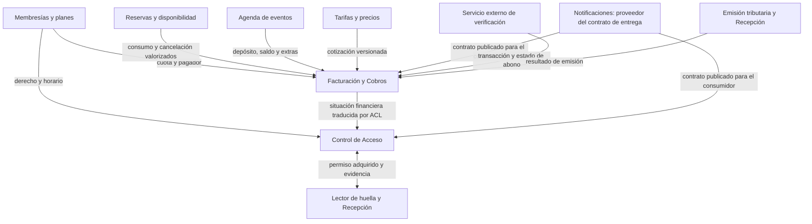

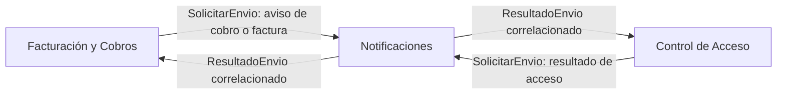

La primera figura representa relaciones entre contratos y consumidores. La segunda muestra el flujo concreto de solicitudes y resultados del servicio de entrega. SolicitarEnvio es un comando del servicio, mientras FacturaEmitida y AccesoSuspendido son *domain events* de los modelos propietarios. El comando puede fallar sin deshacer el hecho que lo originó y su recuperación utiliza una identidad de envío estable.

## 6.3 Datos mínimos por frontera

| Contrato | Campos mínimos | Comprobación del consumidor |
| --- | --- | --- |
| PaqueteContratado | paqueteId, membresiaId, pagadorId, beneficiarios, ciclo, cuota, derechos, horario y versión | El pagador y el período corresponden a la contratación |
| CargoServicio | origenId, tipo, pagadorId, cantidad, precio, descuento, neto, moneda y precioVersion | Origen único, detalle completo e importe autorizado |
| TramoEvento | eventoId, tramoId, depósito o saldo, importe y referencias de tramos previos | No volver a incluir el depósito en el remanente |
| MovimientoVerificable | proveedor, referencia, titular, importe, moneda, estado, abonoId y fechas | Transacción y abono coincidentes; no solo comprobante comunicado |
| SituacionFinanciera | pagadorId, obligaciones relevantes, saldos, vencimientos, conceptos bloqueantes, completa, consultadoEn y versiones | Alcance completo, sujeto correcto y consulta reciente |
| DerechoIngreso | sujetoId, pagadorId cuando aplica, origen, vigencia, horario, restricciones y versión | Derecho válido en el instante solicitado |
| PermisoOperacionHuella | accesoId, operacionId, intentoId, ejecutorId, tipo, dispositivoId y versión adquirida | Existe adquisición guardada y permiso vigente |
| ResultadoOperacion | Identidad de permiso, resultado, operador, ocurridoEn, recibidoEn y evidenciaId | Tipo y ejecutor coinciden; incertidumbre no se transforma en éxito |
| ResultadoEmision | facturaId, intentoId, referenciaFiscal, total, moneda y constancia | El documento y el importe coinciden con la factura preparada |

La consulta financiera identifica todas las obligaciones que afectan al derecho evaluado. Un resultado incompleto no se interpreta como ausencia de deuda y una cuenta saldada no acredita que las restantes también lo estén. La aplicación obtiene una nueva consulta en cada fase que precede al efecto y al confirmar un alta. El límite de antigüedad operativo de treinta segundos reduce el uso de información vieja, aunque no crea una transacción global con el proveedor ni la cerradura.

## 6.4 Estructura básica de API

La interfaz puede exponerse mediante una API *REST* sobre HTTPS con documentos JSON. Los controladores validan estructura y permisos, y delegan las decisiones de negocio en los *Application Services*. Los comandos de escritura incorporan una clave de idempotencia y las actualizaciones administrativas utilizan la versión esperada del objeto. Las rutas siguientes definen una estructura básica y no implican una integración ya desplegada.

| Método y ruta conceptual | Uso | Condición esencial |
| --- | --- | --- |
| `POST /api/v1/cuentas` | Crear obligación con conceptos liquidados | Permiso administrativo y origen de cargo no duplicado |
| `POST /api/v1/pagos/informados` | Recibir referencia y comprobante del cliente | Registrar comunicación sin reducir saldo |
| `POST /api/v1/pagos/{pagoId}/verificaciones` | Conciliar proveedor, movimiento y abono | Servicio administrativo autorizado; datos externos consultados por el servidor |
| `POST /api/v1/cuentas/{cuentaId}/aplicaciones` | Aplicar movimiento ya verificado | Referencia, moneda, cuenta y verificación coherentes |
| `POST /api/v1/devoluciones/{devolucionId}/aprobacion` | Autorizar exceso verificado | Permiso de Dirección y monto dentro del exceso |
| `POST /api/v1/devoluciones/{devolucionId}/ejecucion` | Adquirir y ejecutar devolución | Un responsable adquirido y resultado conciliado |
| `POST /api/v1/facturas` | Preparar documento desde cuenta saldada | Unicidad por cuenta y tipo de documento |
| `POST /api/v1/facturas/{facturaId}/emisiones` | Adquirir intento de emisión | Factura pendiente, sin otro ejecutor activo |
| `POST /api/v1/facturas/{facturaId}/resultados-emision` | Confirmar referencia fiscal | Evidencia del intento adquirido y total coincidente |
| `GET /api/v1/pagadores/{pagadorId}/situacion` | Consultar obligaciones y estado económico | Alcance autorizado, completitud, tiempos y versiones |
| `POST /api/v1/accesos/{accesoId}/suspensiones` | Solicitar suspensión evaluada | Plazo, aviso y deuda de la política |
| `POST /api/v1/accesos/{accesoId}/restablecimientos` | Solicitar alta evaluada | Regularización, vigencia y permiso de Recepción |
| `POST /api/v1/operaciones/{operacionId}/adquisicion` | Asignar un único ejecutor | Versión esperada y estado Solicitada |
| `POST /api/v1/operaciones/{operacionId}/resultados` | Registrar evidencia del acto | Operación, intento, ejecutor y dispositivo correlacionados |
| `POST /api/v1/ingresos/evaluaciones` | Consultar elegibilidad del sujeto y derecho en un instante | Distinguir miembro y derecho temporal confirmado |
| `GET /api/v1/accesos/{accesoId}` | Consultar estado, observación e incidencia | No ocultar incertidumbre bajo un estado histórico |

Los errores distinguen solicitud mal formada, falta de permiso, objeto inexistente, conflicto de versión y rechazo de dominio. Una petición aceptada para actuación externa puede responder con estado pendiente y un identificador consultable. El cliente no reenvía un pago o una actuación física para intentar resolver por sí mismo un estado incierto. Una respuesta de conflicto exige consultar la versión actual y decidir si el resultado ya se produjo antes de insistir.

La cabecera `Idempotency-Key` identifica la intención y se reutiliza en todos sus reintentos. El servidor reserva atómicamente esa clave junto con la función solicitada y una huella del contenido, antes de entregar un efecto externo. Una repetición completa devuelve el resultado conservado, una repetición activa devuelve pendiente con una ruta de consulta y una clave con contenido distinto produce conflicto. Las identidades no caducan mientras la operación o su cadena de reentrega puedan volver a producir el mismo efecto.

| Respuesta HTTP | Significado del contrato |
| --- | --- |
| `200` | Consulta o resultado conocido de una operación completada |
| `201` | Recurso creado con identidad consultable |
| `202` | Coordinación aceptada o repetición de intención todavía activa; incluye ruta de estado |
| `400` | Estructura de entrada inválida |
| `401` o `403` | Actor no autenticado o función no autorizada |
| `404` | Objeto inexistente dentro del alcance autorizado |
| `409` | Conflicto de versión, asociación o reutilización incompatible de clave |
| `422` | Datos bien formados que incumplen una regla del dominio |
| `503` | Dependencia no disponible; no implica ausencia de efecto anterior |

Los errores utilizan una estructura común con codigo, mensaje, correlationId y detalles de validación no sensibles. Las respuestas de servicios externos se validan en el adaptador antes de convertirse en valores de dominio. Los campos que se incorporen sin cambiar significado se agregan de forma compatible y los cambios de significado requieren una nueva versión de contrato. La situación financiera resumida cubre siempre el alcance completo; si el detalle se pagina, una página aislada nunca se interpreta como toda la deuda.

## 6.5 *Webhooks*, *WebSocket* y entrega de eventos

El proveedor puede comunicar cambios mediante un *webhook* firmado. El receptor comprueba firma, identidad del mensaje, transacción y antigüedad antes de guardar la recepción. Después consulta el estado confiable del movimiento y verifica su abono en la empresa, en lugar de considerar suficiente el texto recibido. La entrega repetida se reconoce mediante la identidad externa y la referencia financiera permanece como protección de negocio adicional.

Una vista administrativa puede recibir actualizaciones mediante *WebSocket* o *Server-Sent Events*. El canal comunica que cambió una cuenta, factura u operación y permite refrescar una vista autorizada. No concede permiso para aplicar un pago, emitir otra factura o ejecutar una baja de huella. Después de una reconexión, el cliente consulta el estado actual mediante la API y no supone que recibió todos los mensajes intermedios.

La publicación entre módulos utiliza registros de salida y recepción asociados a la transacción local. Un patrón *outbox* conserva los mensajes que deben salir después del guardado, y un registro *inbox* identifica los ya recibidos. La entrega puede ocurrir más de una vez y cada consumidor mantiene idempotencia según la identidad del hecho y su clave de negocio. Este mecanismo evita perder coordinación por una caída después del pago sin prometer una sola entrega física del mensaje.

```json
{
  "messageId": "MSG-001",
  "tipo": "CuentaSaldada",
  "versionContrato": 1,
  "cuentaId": "CPC-001",
  "pagadorId": "CLI-001",
  "versionOrigen": 4,
  "ocurridoEn": "2026-11-06T12:00:00-04:00",
  "correlationId": "COB-001"
}
```

## 6.6 Emisión y actuación física

Factura pertenece al modelo financiero aunque su emisión definitiva requiera un mecanismo externo. Recepción adquiere el intento, opera el portal o adaptador autorizado y conserva la constancia del resultado. Un conector fiscal por API puede incorporarse después sin cambiar las invariantes de Factura. Si el resultado queda incierto, se consulta por la identidad del intento y la referencia disponible antes de solicitar otra emisión.

La huella se configura mediante un puerto de operación y confirmación. Su contrato exige una única asignación persistida antes de entregar el permiso al operador. La plantilla permanece en el dispositivo y las evidencias administrativas no contienen biometría. La validación del horario debe aplicarse a la apertura, mientras la programación del registro puede realizarse fuera de la franja si la rehabilitación corresponde.

## 6.7 Seguridad y protección de información

El servidor autentica a los operadores y autoriza cada función de acuerdo con sus permisos. Los secretos del proveedor y la firma de mensajes permanecen en adaptadores protegidos y no se exponen al cliente. Los comprobantes y datos de facturación se consultan por referencia mediante permisos específicos, evitando incluirlos completos en los eventos de integración. El registro de actividad conserva actor, acción, objeto, versiones y evidencia mínima para reconstruir la decisión sin almacenar información biométrica.

---

<a id="capitulo-07"></a>

# 7. Modelo de dominio de Facturación y Cobros

## 7.1 *Aggregates* y fronteras de consistencia

Facturación y Cobros contiene dos *aggregates*: CuentaPorCobrar y Factura. CuentaPorCobrar protege la obligación, la aplicación de movimientos verificados y los excesos que deben devolverse. Factura protege el detalle del comprobante, su identidad interna y su relación con la emisión externa. Ambos permanecen en el mismo *Bounded Context*, pero se guardan en transacciones independientes porque confirmar un pago y emitir un comprobante son actuaciones diferentes.

CuentaPorCobrar es la *aggregate root* de la obligación económica. Contiene una colección inmutable de ConceptoCobro, aplicaciones de pago y las entidades internas DevolucionExceso que se originan por movimientos que exceden el saldo. El pagador, el paquete, la reserva, el evento y el período se referencian por identificador y no se incorporan como objetos completos. La raíz concentra todas las operaciones que pueden modificar saldo, aplicaciones y devolución pendiente.

Factura es la *aggregate root* del documento que corresponde a una cuenta saldada. Contiene LineaFactura, DatosFacturacion, referencia a pagos aplicados y el registro de emisión y envío. Sus líneas se copian desde los conceptos liquidados y mantienen el precio comprometido aunque cambien las tarifas. La numeración fiscal y la constancia externa se registran después de verificar el resultado de emisión, sin reemplazar el identificador interno.

| Elemento | Tipo de modelado | Identidad o atributos principales | Dentro de qué frontera |
| --- | --- | --- | --- |
| CuentaPorCobrar | *Aggregate root* | cuentaId, pagadorId, período, total, saldo, estado, versión | CuentaPorCobrar |
| ConceptoCobro | *Value object* | origenId, tipo, descripción, cantidad, precio, descuento autorizado, neto y precioVersion | CuentaPorCobrar |
| AplicacionPago | *Value object* | origen, referencia, importeRecibido, importeAplicado, exceso, moneda y verificacionId | CuentaPorCobrar |
| DevolucionExceso | *Entity* interna | devolucionId, movimientoOrigen, monto, estado, aprobación y resultado | CuentaPorCobrar |
| Dinero | *Value object* | Importe decimal exacto y moneda | Ambas raíces financieras, como valores independientes |
| Factura | *Aggregate root* | facturaId, cuentaId, pagadorId, total, estado, referenciaFiscal y versión | Factura |
| LineaFactura | *Value object* | Descripción, origen, cantidad, precio y neto cobrados | Factura |
| DatosFacturacion | *Value object* | Titular, identificación tributaria y datos mínimos del documento | Factura |
| IntentoEmision | *Entity* interna | intentoId, ejecutor, estado, resultado y constancia de no emisión cuando aplica | Factura |
| ResultadoEmision | *Value object* | Referencia externa, importe, moneda, fecha y constancia verificadas | Factura |

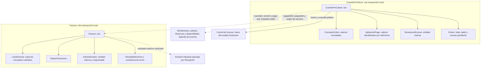

## 7.2 Origen y composición de los cargos

La creación de una cuenta recibe conceptos ya valorizados y autorizados por sus responsables. CalculoDeCobro valida monedas, suma cantidades y descuentos, y obtiene el neto sin inventar una tarifa propia. CuentaPorCobrarFactory reúne ese resultado con el pagador, el vencimiento y la identidad del período u operación. Una cuenta creada mantiene sus conceptos fijos para que el pago y la factura describan exactamente la obligación aceptada.

| Concepto | Identidad mínima del origen | Cálculo y condición conservados | Momento de liquidación |
| --- | --- | --- | --- |
| Cuota del paquete | membresiaId, ciclo y paqueteId | Cuota y derechos del paquete vigente para ese ciclo | Mensual o al contratar pase por día |
| Hora de sala adicional | consumoId, reservaId y período | Cantidad que excede las horas incluidas; precio y descuento comprometidos | Cierre mensual o contratación puntual |
| Alquiler de sala | reservaId y tramo contratado | Franja, recurso y precio aceptado | Anticipado o cierre acordado |
| Cancelación tardía | reservaId y cancelacionId | Franja completa si se cancela con menos de cuatro horas de anticipación | Al confirmar la cancelación cobrable |
| Depósito de evento | eventoId y tramo Deposito | Importe anticipado exigido por la contratación | Antes de confirmar la condición económica del evento |
| Saldo de evento | eventoId y tramo Saldo | Total contratado menos depósito ya liquidado, más extras posteriores autorizados | Según vencimiento del remanente |
| Servicio adicional | servicioId, eventoId o reservaId | Descripción, cantidad, precio y autorización | En la cuenta que corresponda al consumo |

La identidad de cargo se forma con el origen del servicio, el tipo de concepto y el período o tramo. Esa combinación se reserva de forma única en el módulo al crear la cuenta. Una entrega repetida del mismo consumo no crea otro cargo ni cambia la cuenta existente. Si llega una corrección real, debe identificarse como ajuste explícito y conservar su relación con el concepto anterior.

Un evento contratado por BOB 1.000 puede exigir un depósito de BOB 200. La cuenta del depósito contiene ese tramo y, después de verificarse el abono, origina una factura por BOB 200. La cuenta del saldo contiene BOB 800 y referencia el depósito anterior, en lugar de volver a cargar BOB 1.000. Si se autoriza posteriormente un servicio audiovisual de BOB 100, se agrega a una nueva liquidación o al remanente aún no creado, y el total económico del evento pasa a BOB 1.100 sin volver a cobrar el anticipo.

## 7.3 Invariantes de CuentaPorCobrar

| ID | Invariante | Condición de aceptación | Rechazo o consecuencia |
| --- | --- | --- | --- |
| I01 | Total positivo y saldo entre cero y total | Conceptos válidos y total igual a suma de netos | No crear neto cero, negativo o monto manual inconsistente |
| I02 | Misma moneda en conceptos, pagos y devoluciones | Movimiento y cuenta tienen la misma moneda | No aplicar conversión implícita |
| I03 | Solo movimiento verificado reduce saldo | Transacción externa y abono interno conciliados; importe recibido positivo | Comprobante aislado no modifica la obligación |
| I04 | Referencia aplicada una vez con datos originales | Repetición idéntica devuelve YaAplicado | Mismo origen y referencia con monto o cuenta distintos es conflicto |
| I05 | Pendiente equivale a saldo positivo; Saldada equivale a cero | Aplicación limitada al saldo restante | El exceso no vuelve negativo el saldo |
| I06 | Aplicaciones, excesos y eventos se guardan juntos | Movimiento nuevo aceptado en transacción local | Fallo de guardado no publica éxito |

La asociación de origen y referencia con una cuenta se protege además mediante unicidad transaccional del módulo. Una raíz aislada no conoce las aplicaciones guardadas en otra cuenta. Por eso el registro de la asociación y el guardado de la raíz ocurren en la misma transacción financiera. Un conflicto de concurrencia obliga a recargar antes de decidir si la entrega es repetida o incompatible.

## 7.4 Estados y operaciones económicas

La cuenta utiliza Pendiente y Saldada como estados económicos. Un pago parcial conserva Pendiente y reduce el saldo únicamente por el importe verificado. Un movimiento superior al saldo aplica la parte necesaria y registra el resto como ExcesoPago asociado a una DevolucionExceso. Un nuevo movimiento real después de saldar no se descarta como duplicado: queda completamente identificado como exceso, sin segunda transición a Saldada.

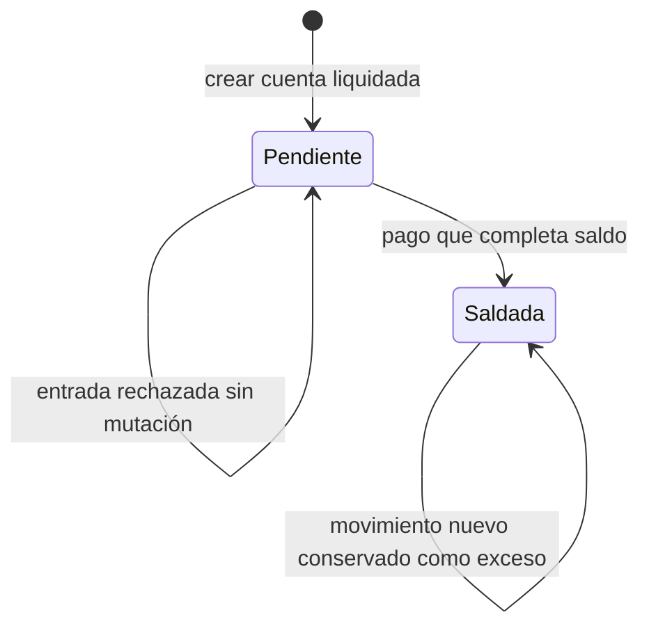

| Estado | Operación | Guarda y resultado económico | Evento o auditoría |
| --- | --- | --- | --- |
| No existe | crearCuenta | Conceptos liquidados, identidad única, total positivo y moneda coherente | CuentaPorCobrarCreada |
| Pendiente | registrarPagoConfirmado | Verificación confiable; aplicar mínimo entre recibido y saldo | PagoRegistrado; CuentaSaldada solo si llega por primera vez a cero |
| Saldada | registrarPagoConfirmado con referencia nueva | Aplicación cero; conservar recibido como exceso | PagoRegistrado y ExcesoPagoIdentificado; no otra CuentaSaldada |
| Cualquiera | registrarPagoConfirmado con referencia idéntica | Comprobar datos originales antes de comparar con saldo actual | YaAplicado, sin eventos nuevos |
| Cualquiera | aprobarDevolucion | Exceso real verificado y autorización de Dirección | Aprobación registrada en entidad interna |
| Cualquiera | adquirirDevolucion | Estado aprobado y un único responsable de ejecución | EnProceso, guardado antes de enviar la devolución |
| Cualquiera | registrarNoEjecucionDevolucion | No salida, ausencia de instrucción en curso y cese reconocidos | Devuelve entidad a Aprobada para otra adquisición; conserva intento cerrado |
| Cualquiera | confirmarDevolucion | Referencia y abono de salida verificados; importe no mayor al exceso | DevolucionConfirmada; la cuenta no se reabre |

<a id="pseudocodigo-financiero"></a>

## 7.5 Pseudocódigo conceptual de CuentaPorCobrar

```text
registrarPagoConfirmado(referencia, importeRecibido, ahora):
  si referencia ya aplicada:
    exigir mismo origen, importe recibido y moneda originales
    devolver YaAplicado sin cambiar saldo ni emitir eventos
  exigir importeRecibido > 0 y moneda igual a la cuenta
  importeAplicado = minimo(importeRecibido, saldo)
  exceso = importeRecibido - importeAplicado
  saldoAnterior = saldo
  conservar AplicacionPago con referencia, recibido, aplicado y exceso
  saldo = saldo - importeAplicado
  estado = Saldada si saldo = 0; de lo contrario Pendiente
  registrar PagoRegistrado con importes diferenciados
  si exceso > 0:
    crear DevolucionExceso Pendiente vinculada al movimiento
    registrar ExcesoPagoIdentificado
  si saldoAnterior > 0 y saldo = 0:
    registrar CuentaSaldada
  devolver Aplicado

aprobarDevolucion(devolucionId, autorizacion, ahora):
  exigir exceso identificado y autorizacion vigente de Direccion
  exigir que la suma devuelta y pendiente no supere el exceso original
  pasar devolucion a Aprobada y conservar autorizacion

adquirirDevolucion(devolucionId, ejecutorId, ahora):
  exigir devolucion Aprobada y ningun intento activo
  asignar ejecutor, crear intento y pasar a EnProceso
  devolver permiso provisional, valido solo despues de guardar y confirmar

registrarNoEjecucionDevolucion(devolucionId, evidencia, ahora):
  exigir no salida, no instruccion en curso y cese reconocido
  cerrar intento sin efecto y volver a Aprobada

confirmarDevolucion(devolucionId, resultadoVerificado, ahora):
  si resultado terminal identico: devolver SinEfecto
  exigir devolucion adquirida por el ejecutor informado
  exigir referencia externa e importe de salida verificados
  pasar a Devuelta y conservar evidencia
  registrar DevolucionConfirmada sin modificar saldo ni factura
```

La precondición de aplicación es que RegistrarPagoService haya obtenido una verificación confiable. El servicio valida el comprobante comunicado, la transacción del proveedor y el abono del registro de la empresa antes de invocar la raíz. Ninguna API permite que el cliente sustituya esa verificación por un campo booleano. La cuenta vuelve a comprobar sus invariantes y conserva los datos originales necesarios para reconocer la misma referencia después de que el saldo ya sea cero.

## 7.6 Procedimiento de pago y devolución

El cliente comunica su comprobante y Recepción registra el pago informado. El servicio de verificación consulta la transacción identificada y la compara con el registro del abono de Nodo. La conciliación exige origen, referencia, pagador, moneda e importe coherentes, y separa la fecha de comunicación de la fecha efectiva del abono. Una autorización de tarjeta sin captura y abono confirmados permanece en verificación y todavía no reduce el saldo.

Un pago parcial de BOB 200 sobre una cuenta de BOB 480 deja BOB 280 pendientes. Un segundo movimiento de BOB 300 aplica BOB 280 y genera un exceso de BOB 20. La factura se prepara por los BOB 480 efectivamente aplicados a los conceptos de la cuenta, mientras el exceso se tramita aparte. Dirección autoriza la devolución del exceso verificado y Recepción registra el resultado de la salida, sin volver a cargar los servicios ni alterar una factura emitida.

La devolución utiliza una identidad estable y una asignación de ejecución guardada antes de actuar. Si se pierde la respuesta del proveedor, el estado queda Incierta y se consulta el movimiento antes de reenviar cualquier instrucción. El vencimiento de un tiempo de espera no demuestra que la salida no ocurrió. La confirmación repetida del mismo resultado conserva una sola devolución y no modifica el saldo que ya estaba saldado.

## 7.7 Factura como parte del modelo financiero

La liquidación mensual establece lo que debe pagarse y puede existir antes de recibir dinero. Factura se prepara cuando la cuenta correspondiente queda saldada mediante movimientos verificados y los datos de facturación están completos. Esta separación permite cobrar cuotas y consumos del mes y, posteriormente, emitir el comprobante que documenta lo cobrado. Las operaciones anticipadas y los depósitos siguen el mismo procedimiento sobre su propia cuenta, con el detalle del tramo contratado.

| ID | Invariante de Factura | Garantía |
| --- | --- | --- |
| I13 | Total igual a suma de LineaFactura y al total aplicado de la cuenta saldada | No facturar el exceso ni omitir conceptos cobrados |
| I14 | Una factura ordinaria por cuenta y tipo de documento | Reentrega de CuentaSaldada no crea otro comprobante |
| I15 | Emitida exige referencia fiscal y resultado externo verificado | Solicitar emisión no equivale a emitir |
| I16 | Líneas emitidas inmutables y envío independiente | Cambio de tarifa o reenvío no modifica el documento |

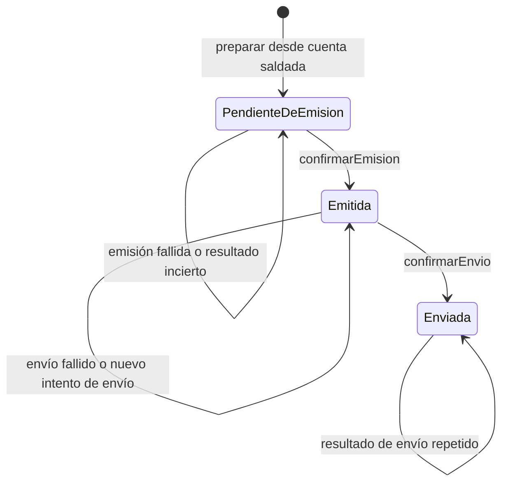

| Operación de Factura | Entrada y guarda | Cambio permitido | Respuesta ante problema |
| --- | --- | --- | --- |
| prepararFactura | Cuenta saldada, conceptos cerrados, datos fiscales y clave de cuenta/documento no usada | Crear líneas, total y PendienteDeEmision | Cuenta aún pendiente o datos incompletos impiden preparar |
| adquirirEmision | PendienteDeEmision sin ejecución activa | Asignar intento y responsable antes de operar el portal | Otro ejecutor no recibe autorización |
| registrarNoEmision | Evidencia de ausencia de emisión, instrucción no vigente y cese reconocido | Cerrar intento sin efecto, conservar PendienteDeEmision | No se vuelve a adquirir por mera expiración |
| confirmarEmision | Resultado de la emisión adquirida, referencia y total coincidentes | Emitida y FacturaEmitida | Incertidumbre conserva pendiente y exige consulta externa |
| registrarFalloEnvio | Emisión existente y resultado de envío fallido | Conservar Emitida y detalle del intento | No volver a emitir factura |
| confirmarEnvio | Constancia de envío del documento correcto | Enviada y FacturaEnviada | Mensaje ajeno o referencia distinta se rechazan |

```text
Factura.preparar(cuentaSaldada, datosFacturacion, identidadDocumento):
  exigir saldo = 0 y total aplicado a conceptos = total de cuenta
  copiar LineaFactura y condiciones economicas cerradas
  exigir total = suma de lineas y moneda coherente
  crear PendienteDeEmision y registrar FacturaPreparada

adquirirEmision(ejecutorId, ahora):
  exigir PendienteDeEmision y ningun intento activo o incierto
  crear IntentoEmision con responsable unico
  devolver permiso provisional, valido solo despues de guardar y confirmar

registrarNoEmision(evidencia, ahora):
  exigir no documento emitido, no instruccion vigente y cese reconocido
  cerrar intento sin efecto; conservar PendienteDeEmision

confirmarEmision(resultado, ahora):
  si mismo resultado ya confirmado: devolver SinEfecto
  exigir intento adquirido, referencia fiscal verificable e importes coincidentes
  conservar ResultadoEmision y pasar a Emitida
  registrar FacturaEmitida

confirmarEnvio(constancia, ahora):
  exigir documento Emitida o Enviada y constancia correspondiente
  si envio identico ya registrado: devolver SinEfecto
  conservar constancia y pasar a Enviada
  registrar FacturaEnviada
```

La creación de Factura no contiene una llamada al proveedor de pagos ni al portal de emisión. La aplicación reúne la cuenta saldada y la evidencia, y la raíz valida que el documento interno pueda nacer. Recepción actúa como responsable de emisión y registra el resultado externo de su intento adquirido. Si la respuesta se pierde, primero consulta la referencia del documento para evitar emitir otro comprobante por la misma cuenta.

## 7.8 Eventos y trazabilidad económica

| Evento | Raíz responsable | Información mínima de negocio |
| --- | --- | --- |
| CuentaPorCobrarCreada | CuentaPorCobrar | Cuenta, pagador, período, total, moneda y vencimiento |
| PagoRegistrado | CuentaPorCobrar | Referencia, recibido, aplicado, exceso, saldo restante y verificación |
| CuentaSaldada | CuentaPorCobrar | Cuenta, pagador, versión y momento de saldo cero |
| ExcesoPagoIdentificado | CuentaPorCobrar | Cuenta, movimiento, devolución y exceso |
| DevolucionConfirmada | CuentaPorCobrar | Devolución, importe y referencia externa de salida |
| FacturaPreparada | Factura | Factura, cuenta, conceptos copiados, total y moneda |
| FacturaEmitida | Factura | Factura, referencia fiscal y fecha de emisión |
| FacturaEnviada | Factura | Factura, envío, canal y constancia |

Cada evento conserva identidad, versión del *aggregate*, instante de ocurrencia y correlación con el comando. La confirmación de persistencia precede a la publicación de integración. La entrega de un evento puede repetirse y el consumidor debe reconocer su identidad antes de reaccionar. Ningún mensaje financiero contiene una instrucción de abrir la puerta ni datos biométricos del miembro.

---

<a id="capitulo-08"></a>

# 8. Modelo de dominio de Control de Acceso

## 8.1 Raíz, entidad interna y referencias

AccesoMiembro es la *aggregate root* del permiso operativo de un miembro. Su identidad permanece aunque se suspenda el ingreso, cambie el plan o se vuelva a registrar la huella. Contiene el estado, la observación de la cerradura, el historial de operaciones y las incidencias que condicionan nuevas actuaciones. Se guarda como una unidad de consistencia y no contiene la cuenta financiera, la membresía completa ni la plantilla biométrica.

OperacionRegistroHuella es una *entity* interna porque conserva identidad y continuidad durante solicitudes, intentos y confirmaciones. EvidenciaFisica, EvaluacionAcceso, ConstanciaAviso y ObservacionRegistroHuella son *value objects* que describen datos inmutables utilizados por la raíz. Un intento registra el ejecutor autorizado y el resultado que se pudo acreditar. La consulta económica se traduce a SituacionPago mediante una *Anti-Corruption Layer* y cubre las obligaciones del pagador que afectan al derecho de ese miembro.

| Componente | Identidad o atributos | Comportamiento protegido | Referencias externas |
| --- | --- | --- | --- |
| AccesoMiembro | accesoId, miembroId, pagadorId, planId, estado, versión y política | Solicitar, confirmar, cancelar y reconciliar operaciones | Cuenta y obligación por identificador; plan por versión |
| OperacionRegistroHuella | operacionId, tipo, estado, parentOperacionId e intentos | Un único ejecutor adquirido y cierre explícito | dispositivoId y ejecutorId |
| IntentoOperacion | intentoId, ejecutor, adquisición y resultado | No reasignar mientras el ejecutor anterior puede actuar | Usuario autorizado y dispositivo |
| EvidenciaFisica | Tipo, operación, intento, responsable y tiempos | Acreditar el efecto concreto o el cese sin efecto | Referencia protegida de la constancia |
| EvaluacionAcceso | Acción, sujeto, pagador, versiones, motivos y momento | Una evaluación válida para la acción y versión actuales | Versiones de plan y situación financiera |
| ObservacionRegistroHuella | Presente, Ausente o Desconocida y fecha | Separar estado histórico de condición física conocida | Dispositivo observado |

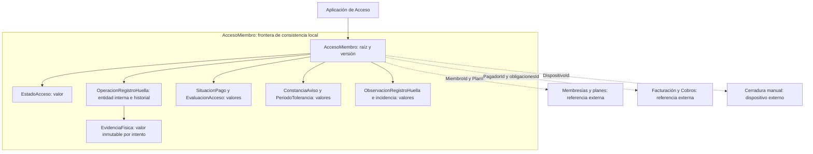

El mecanismo de ingreso utiliza una cerradura con lector de huella. Recepción da de baja el registro para suspender y vuelve a registrarlo para restablecer. Alta y Retiro nombran actuaciones sobre el registro del dispositivo, mientras el sistema conserva únicamente su identificación administrativa. La información biométrica permanece fuera del dominio y no se incluye en mensajes, vistas ni constancias del sistema.

La situación financiera comprende cuotas, consumos y otros cargos que afecten al derecho del miembro. Una deuda de un evento ajeno no se convierte automáticamente en deuda bloqueante de una membresía. En los planes de equipo se identifica el titular pagador y la lista de derechos individuales cubiertos por ese plan. La evaluación rechaza alcances incompletos para evitar que saldar una sola cuenta se interprete como regularización de todas las obligaciones exigibles.

## 8.2 Invariantes y política temporal

| ID | Enunciado y procedencia | Ejemplo / rechazo |
| --- | --- | --- |
| I07 | La suspensión por impago solo se solicita desde Habilitado cuando existe obligación bloqueante vencida, plazo de cinco días y aviso de veinticuatro horas cumplidos | Antes del quinto día, aviso insuficiente, alcance incompleto o ausencia de deuda vencida fuera de tolerancia rechazan |
| I08 | Suspendido exige evidencia válida de registro de huella dado de baja/ausente: confirmación ordinaria, retiro correctivo o reconciliación física expresa | Orden enviada, *timeout* o alta fallida no acreditan retiro; la corrección exige otra operación identificada |
| I09 | Solicitar alta ordinaria exige Suspendido, obligaciones exigibles regularizadas, plan vigente y permiso explícito; habilitar exige alta observada y reevaluación de rehabilitación favorable | Pago sin vigencia rechaza; resultado incierto nunca habilita |
| I10 | Como máximo una operación no terminal por acceso; solo un ejecutor/intento adquirido y persistido puede actuar | Dos ejecutores de la misma versión no reciben ambos autorización |
| I11 | Reintentar reutiliza operacionId con intento nuevo y evaluación reciente; terminales idénticos no mutan ni reemiten eventos | No reenviar tras *timeout*, no liberar por mero vencimiento de un bloqueo |
| I12 | Referencias externas por ID y ausencia de biometría en dominio, ejemplos y eventos | Evidencia no contiene plantilla o foto de huella |

La tolerancia adoptada es de cinco días calendario desde el vencimiento de cada obligación que puede bloquear el derecho de acceso. Se exige además un aviso exitoso con al menos veinticuatro horas de anticipación. La fecha efectiva de corte es el máximo entre vencimiento más cinco días y envío acreditado más veinticuatro horas. Esta regla permite avisar tarde sin retrofechar el mensaje ni ejecutar una suspensión que carezca del margen previo.

| Dato o situación | Regla operativa adoptada | Resultado |
| --- | --- | --- |
| Obligación vence el 1 de noviembre a las 09:00 | Límite económico: 6 de noviembre a las 09:00, America/La_Paz | Antes del límite no se solicita suspensión por esa obligación |
| Aviso enviado el 2 de noviembre a las 10:00 | Margen de aviso termina el 3 de noviembre a las 10:00 | Corte posible desde el 6 de noviembre a las 09:00 si persiste deuda |
| Aviso enviado el 6 de noviembre a las 12:00 | El margen termina el 7 de noviembre a las 12:00 | El corte espera hasta ese instante |
| Plan de horario normal | Lunes a viernes, intervalo 08:00 a 18:00, fin excluido | Un intento a las 18:00 queda fuera de horario |
| Plan con acceso continuo | Todos los días, dentro de la vigencia contratada | El horario no restringe, pero deuda y vigencia siguen evaluándose |
| Pago y alta a las 20:00 | Se permite configurar si corresponde rehabilitar | El intento de ingreso depende del horario del plan |

Rehabilitar el registro e ingresar son acciones distintas. La rehabilitación exige obligaciones exigibles regularizadas, derecho vigente y permiso de Recepción bajo la política de Dirección. Cada entrada agrega la restricción horaria y la ausencia de incidencias que impidan confiar en el estado. El adaptador de apertura debe aplicar esa evaluación; configurar una huella no puede presentarse como autorización de ingreso fuera del horario contratado.

## 8.3 Ciclo de OperacionRegistroHuella y exclusión previa al efecto

Los tipos de operación son RetiroImpago, Alta y RetiroCorrectivo. Cada operación conserva su parentOperacionId si corrige otra y un historial de intentos. Confirmada y Cancelada son terminales; Solicitada, EnEjecucion y ResultadoIncierto son no terminales. Conservar historia permite reconocer duplicados después de cerrar la operación. Confirmar o cancelar libera el cupo de operación vigente; un terminal no autoriza nuevos efectos de esa identidad.

| Origen de operación | Método de raíz / guarda | Destino y significado |
| --- | --- | --- |
| No existe | Solicitud ordinaria/correctiva válida; no hay otra no terminal | Solicitada, sin permiso físico todavía |
| Solicitada | adquirirEjecucion(operacionId, ejecutorId, ahora), guardar con versionEsperada y confirmar *commit* | EnEjecucion con intentoId nuevo; solo el ganador recibe autorización para actuar |
| EnEjecucion | Evidencia positiva del intento, operación/tipo/ejecutor/dispositivo correctos | Confirmada; aplicar transición de acceso y conservar resultado original |
| EnEjecucion o ResultadoIncierto | registrarResultadoIncierto(operacionId, ahora) o sin evidencia de no efecto | ResultadoIncierto; no entregar otra orden ni liberar ejecutor automáticamente |
| EnEjecucion o ResultadoIncierto | registrarNoEjecucion(evidencia, ahora): operador acredita no efecto, ausencia de actuación en curso y cese de autorización anterior | Solicitada; intento anterior cerrado sin efecto, elegibilidad se reevalúa antes de adquirir otro |
| Solicitada | Cancelación con evaluación que invalida motivo y evidencia de no efecto/no intento activo | Cancelada; transición de acceso correspondiente, sin evento de éxito físico |
| Confirmada o Cancelada | Resultado idéntico al conservado | SinEfecto; no nuevo evento ni actuación |
| Terminal o intento antiguo | Evidencia contradictoria de acto real | registrarEvidenciaContradictoria(evidencia, ahora) conserva historial, abre incidencia y congela; luego reconciliarResultadoFisico |

Confirmada acredita el efecto de un intento identificado. Cancelada ordinaria acredita no efecto; excepcionalmente, reconciliarResultadoFisico puede cerrar una operación irresoluble como Cancelada con motivo ReconciliacionSinAtribucion, después de cese e inspección actual. Esa variante conserva el resultado histórico Desconocido y no afirma que nunca hubo efecto. Si hay evidencia atribuible al intento, se cierra Confirmada. Así ninguna operación antigua queda autorizada para actuar tras la normalización, sin fabricar una historia física.

La adquisición se guarda atómicamente **antes** de entregar la tarea física, usando la versión de AccesoMiembro. El segundo escritor recarga y no actúa. La asignación/aceptación manual debe respetar esa exclusión; un registro en memoria de un único proceso solo ofrece esta garantía dentro de ese proceso. No se afirma bloqueo entre procesos que no compartan almacenamiento y protocolo.

Una caída después de adquirir, incluso antes de saber si el operador recibió la tarea, conserva ejecución/resultado incierto. No hay reasignación por *timeout* ni *lease* que «venza» mientras el operador antiguo puede actuar. Se exige cierre/revocación reconocida de su autorización y evidencia manual de no ejecución o resultado real antes de reasignar. Si no puede obtenerse, se mantiene revisión sin prometer recuperación automática. El contrato de integración exige conservar esa exclusión también en la coordinación humana.

## 8.4 Estado de acceso y tabla de transiciones

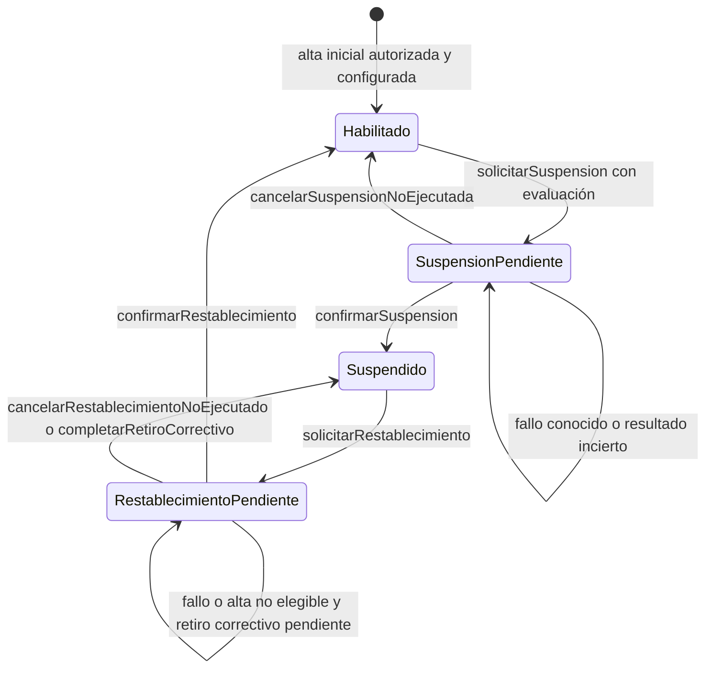

El estado de acceso conserva cuatro posibilidades con significados operativos distintos. En RestablecimientoPendiente la observación puede ser Presente con incidencia: por ello la vista debe mostrar estado, operación, observación y revisión, sin afirmar que la puerta está bloqueada. Habilitado es disponibilidad operativa del registro de huella con derechos y cada ingreso sigue sujeto al horario. La evaluación de entrada exige además una observación confiable sin congelación.

| Origen | Método | Guarda / dueño de decisión | Destino, operación y evento |
| --- | --- | --- | --- |
| Habilitado | solicitarSuspension(evaluacion, ahora) | Raíz valida evaluación Suspender favorable, contexto y ausencia de operación; evaluador ya comprobó política I07 | SuspensionPendiente; RetiroImpago Solicitada; SuspensionSolicitada |
| SuspensionPendiente | confirmarSuspension(evidencia, ahora) | Retiro real acreditado del intento adquirido | Suspendido y observación Ausente; operación Confirmada; AccesoSuspendido, aun si se pagó durante retirada |
| SuspensionPendiente | cancelarSuspensionNoEjecutada(evaluacion, evidencia, ahora) | Evaluación Suspender actual desfavorable porque ya no existe motivo vigente para la suspensión; no efecto ni intento activo | Habilitado, operación Cancelada; auditoría, sin AccesoRestablecido por alta inexistente |
| Suspendido | solicitarRestablecimiento(evaluacion, autoridad, ahora) | Evaluación Restablecer favorable y autoridad explícita; sin operación no terminal | RestablecimientoPendiente, Alta Solicitada; RestablecimientoSolicitado |
| RestablecimientoPendiente | confirmarRestablecimiento(evidencia, evaluacion, ahora) | Alta real y evaluación Restablecer actual favorable | Habilitado/Presente; Alta Confirmada; AccesoRestablecido |
| RestablecimientoPendiente | cancelarRestablecimientoNoEjecutado(evaluacion, evidencia, ahora) | Evaluación Restablecer desfavorable; no efecto y ningún intento activo | Suspendido/Ausente; Alta Cancelada; solo auditoría |
| RestablecimientoPendiente | registrarAltaNoElegible(evidencia, evaluacion, ahora) | Alta real pero evaluación Restablecer desfavorable o NoEvaluable | Mantiene pendiente, observación Presente e incidencia; Alta Confirmada y cerrada; no AccesoRestablecido |
| RestablecimientoPendiente con incidencia | solicitarRetiroCorrectivo(autoridad, ahora) | Alta no elegible registrada; permiso de corrección de Recepción; no otra operación ni ejecutor activo | RetiroCorrectivo Solicitada con parentOperacionId; mantiene pendiente, auditoría; no se inventa deuda ni SuspensionSolicitada por impago |
| RestablecimientoPendiente con correctiva | completarRetiroCorrectivo(evidencia, ahora) | Retiro confirmado del intento correctivo adquirido | Suspendido/Ausente, correctiva Confirmada, incidencia resuelta; AccesoSuspendido con motivo CorreccionElegibilidad |
| Cualquiera, con evidencia de terminal/intento antiguo incompatible | registrarEvidenciaContradictoria(evidencia, ahora) | Evidencia correlacionada auténtica que contradice resultado/historial; no simple mensaje mal formado | Conserva evidencia previa y nueva, abre incidencia y congela despachos; observación actual Desconocida, conserva última observación en historial; no cambia estado principal ni emite éxito |
| Cualquiera, con despachos congelados | reconciliarResultadoFisico(evidenciaInspeccion, evaluacion, autoridad, ahora) | Inspección actual posterior a cese confirmado de ejecutores; evidencia previa contradictoria conservada; sin actuación en curso | Ausente: Suspendido; Presente y Restablecer favorable: Habilitado; Presente no elegible: RestablecimientoPendiente con incidencia y retiro correctivo. Cierra Confirmada solo con evidencia atribuible al intento; si irresoluble, Cancelada por ReconciliacionSinAtribucion conservando resultado histórico Desconocido |

La última fila es una **normalización excepcional desde cualquiera de los cuatro estados**, fuera del ciclo ordinario del diagrama: observa situación física actual después de cesar operadores, no aplica a ciegas la hora de un mensaje antiguo. Emite AccesoSuspendido o AccesoRestablecido solo si la inspección acredita ese resultado y cambia el estado final; si ya era el mismo, solo registra evidencia/incidencia sin duplicar evento. Al normalizar tras cese/inspección, se cierran las autorizaciones anteriores y se levanta la congelación por evidencia incompatible. Si Presente no elegible, permanece la incidencia de corrección: solo permite adquirir RetiroCorrectivo, nunca alta ni ingreso. Para Presente no elegible no emite éxito de rehabilitación. Si no hay certeza física o cese de operadores, no normaliza estado: mantiene incidencia y congelación. Mientras no pueda normalizarse, el estado principal conserva el último resultado confirmado y la observación Desconocida advierte que no acredita la condición física actual. Una incidencia bloqueante impide evaluarIngreso favorable incluso si el estado histórico era Habilitado. Ningún controlador escribe estados directamente.

<a id="contratos-raiz-acceso"></a>

## 8.5 Contratos conceptuales de la raíz

EvaluacionAcceso es un *value object* generado únicamente por EvaluadorDeIngreso del dominio de Acceso. Contiene evaluacionId, acción Suspender/Restablecer/Ingresar, resultado, motivos, miembroId, pagadorId, obligacionesVersion, accesoVersion, versiones/fechas de insumos, politicaVersion y evaluadoEn. El contexto conserva además observación e incidencia bloqueante/congelación para impedir ingreso con estado histórico no confiable. La aplicación no puede convertir un booleano del cliente en evaluación. La raíz valida procedencia del dominio, acción, sujeto, pagador, alcance de obligaciones, versión de acceso, política y contexto temporal de su invocación; un conflicto obliga a recargar y reevaluar. La consulta debe haberse obtenido en la fase actual y no superar treinta segundos al decidir; consultar de nuevo no elimina la posibilidad de una carrera externa.

```text
solicitarSuspension(evaluacion, ahora):
  exigir Habilitado y ninguna operación no terminal
  validarContextoEvaluacion(evaluacion, Suspender, ahora)
  exigir resultado favorable
  crear RetiroImpago Solicitada y pasar a SuspensionPendiente
  registrar SuspensionSolicitada; ningún permiso físico antes de adquirir

solicitarRestablecimiento(evaluacion, autoridad, ahora):
  exigir Suspendido y ninguna operación no terminal
  validarContextoEvaluacion(evaluacion, Restablecer, ahora)
  exigir favorable y autoridad válida para la operación
  crear Alta Solicitada y pasar a RestablecimientoPendiente
  registrar RestablecimientoSolicitado con evaluacionId

adquirirEjecucion(operacionId, ejecutorId, ahora):
  exigir operación Solicitada, sin incidencia que congele despachos
  crear intentoId; asignar ejecutor único; pasar operación a EnEjecucion
  devolver adquisición provisional: solo autoriza actuar tras guardar con versión y commit

confirmarSuspension(evidencia, ahora):
  si resultado terminal idéntico: SinEfecto
  exigir retiro real, operación RetiroImpago e intento/ejecutor correlacionados
  cerrar operación Confirmada; registrar observación Ausente
  pasar a Suspendido; registrar AccesoSuspendido

confirmarRestablecimiento(evidencia, evaluacion, ahora):
  si resultado terminal idéntico: SinEfecto
  exigir Alta real del intento adquirido y evaluación Restablecer actual favorable
  cerrar Alta Confirmada; observar Presente; pasar a Habilitado
  registrar AccesoRestablecido

registrarAltaNoElegible(evidencia, evaluacion, ahora):
  exigir Alta real y evaluación Restablecer actual desfavorable o NoEvaluable
  cerrar Alta Confirmada conservando hecho, observar Presente e incidencia
  mantener RestablecimientoPendiente; no emitir AccesoRestablecido

solicitarRetiroCorrectivo(autoridad, ahora):
  exigir incidencia de presencia no elegible, cese del alta y ninguna operación vigente
  crear RetiroCorrectivo Solicitada con parentOperacionId y autoridad de corrección
  mantener RestablecimientoPendiente; auditar solicitud correctiva

completarRetiroCorrectivo(evidencia, ahora):
  exigir retiro real del intento correctivo adquirido
  cerrar Confirmada; observar Ausente, resolver incidencia y pasar a Suspendido
  registrar AccesoSuspendido con motivo CorreccionElegibilidad
```

registrarEvidenciaContradictoria conserva evidencia y congela mediante la raíz. reconciliarResultadoFisico normaliza únicamente después del cese y la inspección requeridos por la tabla. No se oculta ni elimina la evidencia contradictoria. La clausura del intento anterior no concede permiso a su ejecutor para volver a actuar.

Los métodos registrarAviso(constancia, ahora), registrarNoEjecucion(evidencia, ahora), registrarResultadoIncierto(operacionId, ahora), las dos cancelaciones y reconciliarResultadoFisico tienen las guardas y efectos completos de §§8.3–8.4. RegistrarAviso comprueba envío exitoso, sujeto, obligaciones y tiempo; no envía mensajes desde la raíz. Todas las mutaciones guardan estado, operación, historial, observación, evidencia, versión y eventos pendientes en una transacción local. Un fallo de guardado conserva el resultado externo por recuperar y no ordena repetirlo.

## 8.6 Carreras, inspección y límites

Si el pago llega antes del retiro, el ejecutor que ganó adquisición revalida deuda; si aún no actuó, acredita no ejecución/cese y cancela por raíz. Si el pago llega durante retirada y el retiro ocurrió, se confirma el hecho y se inicia evaluación de rehabilitación en otra transacción. Si un alta ocurrió y cambió la elegibilidad, registrarAltaNoElegible cierra esa operación sin habilitar. La correctiva tiene otro identificador y no se ejecuta hasta adquirirla.

La confirmación idéntica de operación terminal es idempotente aun si hay operaciones posteriores. Una confirmación incompatible no reabre el terminal ni vuelve a actuar: la raíz registra esa evidencia, abre incidencia y congela despachos mediante registrarEvidenciaContradictoria. Recepción confirma cese de operadores e inspecciona el estado actual antes de reconciliarResultadoFisico. Solo la inspección actual permite elegir el resultado de la fila excepcional; un mensaje viejo no sustituye observación actual. Si no se puede cesar/inspeccionar, el caso sigue pendiente con responsable y sin reintento automático.

Estas reglas reducen órdenes duplicadas dentro de un protocolo compartido; no vuelven idempotente el hardware ni prometen una transacción global con pago/plan. Dirección establece la política y autoriza el alta inicial del miembro. Recepción dispone del permiso ordinario de rehabilitación y corrección cuando las condiciones se cumplen. Las excepciones requieren una autorización explícita de Dirección y no alteran el registro financiero. La identidad y el alcance del permiso se conservan en cada operación.

## 8.7 Eventos y evidencias

| Evento | Cuándo se produce | Datos mínimos además del sobre v1 |
| --- | --- | --- |
| SuspensionSolicitada | Solicitud ordinaria de impago admitida | accesoId, miembroId, pagadorId, obligacionesId, operacionId, evaluacionId, motivo, solicitadoEn |
| AccesoSuspendido | Retiro ordinario confirmado; también correctivo o inspección excepcional acreditada con cambio a Suspendido | accesoId, miembroId, operacionId o reconciliacionId, evidenciaId, motivo, ocurridoEn, confirmadoEn |
| RestablecimientoSolicitado | Solicitud ordinaria de alta elegible | accesoId, miembroId, operacionId, evaluacionId, solicitadoEn |
| AccesoRestablecido | Alta confirmada y elegible; inspección excepcional Presente elegible que cambia a Habilitado | accesoId, miembroId, operacionId o reconciliacionId, evaluacionId, evidenciaId, ocurridoEn, confirmadoEn |

El sobre diferencia tiempo del acto/inspección de tiempo de recepción y de *commit*. La evidencia identifica tipo, dispositivo, operación, intento, ejecutor y resultado; una inspección usa reconciliacionId y constancia de cese. No se exige crear eventos nuevos de éxito para adquirir, cancelar o registrar una incidencia: estos hechos auxiliares quedan en auditoría transaccional, sin falsear los cuatro eventos de negocio canónicos. Cada publicación ocurre después de confirmar el guardado local.

---

<a id="capitulo-09"></a>

# 9. Componentes y responsabilidades del modelo

## 9.1 Distribución del comportamiento

Las reglas que dependen del estado de una raíz permanecen dentro de esa raíz. CuentaPorCobrar modifica saldo y aplicaciones, Factura protege líneas y emisión, y AccesoMiembro controla operaciones de huella. Los cálculos que combinan valores sin pertenecer naturalmente a una entidad se expresan como *Domain Services*. La aplicación obtiene información externa, inicia las transacciones y decide cuándo volver a consultar, sin sustituir las decisiones del dominio.

| Responsabilidad | Componente | Justificación |
| --- | --- | --- |
| Saldo, aplicaciones y excesos | CuentaPorCobrar | Los datos deben cambiar juntos para conservar la igualdad económica |
| Total documental y estado fiscal | Factura | Las líneas y su confirmación de emisión forman una unidad |
| Derecho operativo y evidencia de huella | AccesoMiembro | La confirmación cierra el intento y cambia el estado en una transacción |
| Sumar conceptos y descuentos autorizados | CalculoDeCobro | Combina valores de servicios distintos sin consultar almacenamiento |
| Contrastar comprobante, transacción y abono | ConciliadorDePago | Produce una conclusión identificada a partir de evidencia ya obtenida |
| Evaluar suspensión, rehabilitación e ingreso | EvaluadorDeIngreso | Combina derecho, situación económica, tiempo y política |
| Consultar proveedor y persistir | *Application Service* y adaptadores | Son coordinación y efectos externos, no invariantes de una entidad |

## 9.2 Contratos de *Domain Services*

| Servicio | Firma conceptual | Resultado y reglas |
| --- | --- | --- |
| CalculoDeCobro | calcular(conceptos, moneda, autorizaciones) | Desglose y neto; exige mismo tipo monetario, origen y descuento autorizado |
| ConciliadorDePago | evaluar(comprobanteOpcional, transaccion, abono, cuentaObjetivo) | PagoVerificado o discrepancia; contrasta origen, titular, referencia, importe y moneda |
| EvaluadorDeIngreso | evaluarSuspension(contexto, situacion, avisos, ahora) | EvaluacionAcceso para Suspender; obligación relevante, cinco días y aviso de veinticuatro horas |
| EvaluadorDeIngreso | evaluarRestablecimiento(contexto, situacion, plan, politica, ahora) | EvaluacionAcceso para Restablecer; obligaciones exigibles regularizadas y derecho vigente |
| EvaluadorDeIngreso | evaluarIngreso(contexto, situacion, plan, ahora) | EvaluacionAcceso para Ingresar de un miembro; derecho vigente, horario permitido, estado confiable y política económica |
| EvaluadorDeIngreso | evaluarDerechoTemporal(derecho, ahora) | Resultado de ingreso temporal; sujeto, origen, intervalo y condiciones confirmadas por Reservas o Agenda de eventos |

Los servicios son puros y no consultan APIs ni guardan objetos. La aplicación les entrega valores que ya obtuvo de los puertos correspondientes. ConciliadorDePago no acepta un campo de confirmación declarado por el cliente y no confunde autorización de tarjeta con abono. EvaluadorDeIngreso produce una evaluación para una acción concreta y la raíz comprueba que todavía corresponde a su identidad, versión y política.

El contexto de acceso de un miembro contiene accesoId, miembroId, pagadorId, estado, observación, incidencia, accesoVersion y politicaVersion. SituacionPago conserva el alcance de obligaciones, sus vencimientos y versiones, y la fecha de consulta. Los avisos identifican las obligaciones comunicadas y la fecha efectiva de envío, de modo que el servicio puede calcular el corte aplicable. La evaluación conserva esos datos de contexto, sus motivos y su momento, con resultados Favorable, Desfavorable o NoEvaluable.

La rehabilitación permite configurar fuera del horario de entrada si las condiciones económicas y de vigencia están satisfechas. La evaluación de ingreso agrega el horario y la ausencia de una incidencia bloqueante. Durante la tolerancia se puede mantener el derecho del miembro aunque exista una obligación pendiente, siempre que no haya llegado una condición de corte aplicable. Una situación incompleta o fuera de la antigüedad permitida se trata como NoEvaluable y requiere nueva consulta.

Los derechos temporales se evalúan sin fabricar un AccesoMiembro para el visitante. El contrato del subdominio responsable confirma la contratación y las condiciones económicas del derecho identificado. El servicio comprueba sujeto, origen, vigencia, restricciones y actualidad de esa confirmación. Recepción puede autorizar una apertura supervisada bajo ese resultado y conserva un registro de actuación, sin alta biométrica del visitante ni otro repositorio de membresía.

## 9.3 *Repositories* por *aggregate root*

```text
CuentaPorCobrarRepository
  obtener(cuentaId) -> raiz y version, o Ausente
  guardar(cuenta, versionEsperada) -> nueva version, o Conflicto

FacturaRepository
  obtener(facturaId) -> raiz y version, o Ausente
  guardar(factura, versionEsperada) -> nueva version, o Conflicto

AccesoMiembroRepository
  obtener(accesoId) -> raiz y version, o Ausente
  guardar(acceso, versionEsperada) -> nueva version, o Conflicto
```

Se definen tres interfaces de *Repository*, una por *aggregate root*. Las entidades internas no obtienen un repositorio propio porque se guardan a través de su raíz. La carga entrega una instancia rehidratada independiente del estado persistido, y una mutación que todavía no se confirmó no cambia el almacenamiento compartido. Guardar verifica la versión y conserva todos los componentes internos y eventos pendientes en una transacción local.

El módulo financiero coordina las restricciones de origen del cargo, referencia del movimiento y factura por cuenta. Esas claves se reservan atómicamente junto con la raíz que corresponda. La consulta pública de situación económica no concede acceso al repositorio financiero desde Control de Acceso. Si existe un conflicto de versión, la aplicación recarga y vuelve a evaluar antes de decidir si falta una actuación o si el resultado ya se produjo.

## 9.4 Creación de objetos y *Factory*

CuentaPorCobrarFactory aporta valor al reunir conceptos valorizados, pagador, moneda, período y vencimiento. Invoca CalculoDeCobro y construye una obligación válida sin emitir facturas ni confirmar pagos. Factura.preparar copia el detalle de la cuenta saldada y valida la coherencia del documento dentro de la propia raíz. AccesoMiembro.registrar conserva identidad y evidencia del alta inicial sin añadir una *Factory* que solo duplique esa creación.

La rehidratación se diferencia de la creación de negocio. Volver a cargar una cuenta no registra otro evento de creación y no vuelve a liquidar el servicio. Recuperar Factura conserva la referencia fiscal y las líneas originales aunque la tarifa del servicio ya haya cambiado. Recuperar AccesoMiembro conserva operaciones terminales para reconocer confirmaciones antiguas sin ejecutar otra vez una actuación.

## 9.5 Puertos de integración

| Puerto | Operación conceptual | Resultado o error significativo |
| --- | --- | --- |
| CargosServiciosPort | Obtener conceptos confirmados de paquetes, reservas y eventos | Conceptos identificados; origen incompleto no se liquida |
| VerificacionPagoPort | Consultar transacción externa por referencia | Estado, importe, moneda, titular y datos verificables |
| RegistroAbonosPort | Consultar abono empresarial correspondiente | Abono confirmado, pendiente o discrepancia |
| DevolucionPort | Ejecutar o consultar devolución con identidad estable | Salida confirmada, no ejecutada o incierta |
| EmisionFacturaPort | Operar o registrar emisión y consultar resultado | Referencia fiscal confirmada, fallo o incertidumbre |
| SituacionFinancieraPort | Consultar obligaciones del pagador y alcance | Situación completa, fecha y versiones |
| MembresiaPort | Consultar derecho, beneficiarios, vigencia y horario | Derecho identificado y versionado |
| OperacionHuellaPort | Entregar tarea adquirida y consultar efecto o cese | Evidencia de alta, baja, no ejecución o incertidumbre |
| AvisosPort | Solicitar envío y consultar resultado | Enviado, Fallido o Incierto con identidad correlacionada |
| Reloj | Obtener instante de la fase actual | Fecha con zona y calendario de política |

## 9.6 *Application Services*

| Caso | Servicio | Coordinación principal |
| --- | --- | --- |
| CU01 | LiquidarCuentaService | Obtener cargos, crear cuenta y reservar orígenes |
| CU02 | RegistrarPagoService | Verificar movimiento y abono, aplicar pago y coordinar publicación |
| CU03 | GestionarDevolucionService | Comprobar autorización, adquirir ejecución y confirmar salida |
| CU04 | EmitirFacturaService | Consultar cuenta saldada, preparar Factura y confirmar emisión adquirida |
| CU05 | EnviarFacturaService | Enviar el documento emitido y registrar constancia |
| CU06 | SuspenderAccesoService | Consultar obligaciones y avisos, evaluar y solicitar baja |
| CU07 | RestablecerAccesoService | Consultar regularización y derecho, evaluar y solicitar alta |
| CU08 | CompletarOperacionPendienteService | Adquirir, revalidar, consultar resultado, confirmar o corregir |
| CU09 | EvaluarIngresoService | Consultar estado, derecho y situación económica para una entrada concreta |

Los servicios reciben actor y correlación desde una entrada autenticada. Obtienen un instante nuevo al comenzar cada fase y vuelven a consultar si cambian los datos o la versión de una raíz. Un evento recibido puede despertar el servicio, pero no sustituye el contrato de consulta que necesita para decidir. Las transacciones financieras y de acceso permanecen independientes aunque se ejecuten dentro del mismo proceso.

## 9.7 Dependencias por capas

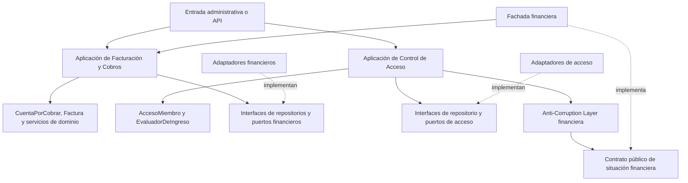

Las dependencias de uso apuntan hacia interfaces y comportamiento del modelo. Los adaptadores implementan los contratos de persistencia, consulta y actuación externa. Las raíces no importan HTTP, el servicio tributario, el proveedor bancario ni el lector de huella. La composición conecta esas implementaciones sin permitir que una entrada administrativa escriba directamente el saldo, la referencia fiscal o el estado del acceso.

## 9.8 Permisos y registro de actividad

Recepción utiliza permisos diferenciados para administrar cargos, conciliar pagos, emitir documentos y operar la huella. Dirección aprueba descuentos especiales, devolución de excesos y excepciones documentadas. Que una persona desempeñe varias funciones no elimina la identificación de cada paso. La auditoría operativa registra actor, función, objeto, comando, versiones, motivo y referencia de evidencia protegida.

---

<a id="capitulo-10"></a>

# 10. Casos de uso y coordinación de operaciones

## 10.1 Entradas, permisos y resultados

Los casos de uso describen la coordinación entre información externa y comportamiento del dominio. Una entrada autenticada identifica al actor, su función, el objeto y la correlación de la operación. La aplicación valida estructura, obtiene datos confiables y llama a la raíz o al servicio de dominio correspondiente. Las respuestas distinguen Aplicado, YaAplicado, Pendiente, Rechazado, Conflicto y RequiereRevision, sin crear nuevos estados económicos por cada error.

| Caso | Actor o función | Entrada principal | Resultado observable |
| --- | --- | --- | --- |
| CU01 LiquidarCuenta | Recepción administrativa | Pagador, período u operación y conceptos confirmados | Cuenta Pendiente con detalle y vencimiento |
| CU02 RegistrarPago | Recepción administrativa | Cuenta, referencia, comprobante opcional y movimiento | Aplicación verificada, saldo y posible exceso |
| CU03 GestionarDevolucion | Dirección y Recepción | Exceso, autorización y ejecución identificada | Devolución confirmada o incierta sin alterar el cobro |
| CU04 EmitirFactura | Recepción como responsable de emisión | Cuenta saldada, datos fiscales y resultado de emisión | Factura PendienteDeEmision o Emitida |
| CU05 EnviarFactura | Recepción y Notificaciones | Factura emitida, destinatario y envío | Enviada solo con constancia |
| CU06 SuspenderAcceso | Recepción autorizada | Miembro, obligaciones, avisos y momento | SuspensionPendiente, sin baja ficticia |
| CU07 RestablecerAcceso | Recepción autorizada | Regularización, derecho y permiso operativo | RestablecimientoPendiente, sin alta ficticia |
| CU08 CompletarOperacionPendiente | Recepción y coordinador | Operación, intento, evidencia y versión | Confirmación, cancelación o revisión explícita |
| CU09 EvaluarIngreso | Controlador y Recepción | Sujeto, derecho y momento | Evaluación de una entrada concreta |

## 10.2 Liquidar y verificar el cobro de servicios

```text
LiquidarCuentaService.ejecutar(solicitud):
  autorizar funcion administrativa y validar pagador, periodo y moneda
  obtener conceptos confirmados de paquetes, reservas y eventos
  exigir origen, cantidad, precio comprometido y autorizaciones completos
  desglose = CalculoDeCobro.calcular(conceptos, moneda, autorizaciones)
  cuenta = CuentaPorCobrarFactory.crear(identidad, pagador, desglose, vencimiento)
  abrir transaccion financiera
    reservar claves unicas de los cargos
    guardar cuenta y eventos pendientes
  confirmar transaccion y disponer publicacion

RegistrarPagoService.ejecutar(solicitud):
  autorizar funcion de conciliacion; cargar cuenta objetivo
  obtener transaccion por VerificacionPagoPort
  obtener abono correspondiente por RegistroAbonosPort
  verificacion = ConciliadorDePago.evaluar(comprobanteOpcional, transaccion, abono, cuenta)
  si no se confirma coincidencia: registrar discrepancia y devolver RequiereRevision
  abrir transaccion financiera
    cargar cuenta actual y version
    comprobar asociacion unica de origen y referencia con cuenta
    invocar registrarPagoConfirmado(referencia, importeVerificado, reloj.ahora())
    si nuevo movimiento: guardar raiz, asociacion y eventos juntos
  confirmar transaccion; publicar despues del guardado
  devolver aplicado, exceso y saldo restante
```

El servicio de conciliación no modifica la cuenta si el proveedor todavía no acredita el abono. La raíz reconoce una referencia aplicada antes de comparar el movimiento con el saldo actual. Esa secuencia permite repetir la misma comunicación después de saldar y obtener YaAplicado, sin generar otra aplicación ni devolución. Un movimiento real adicional conserva una referencia diferente y se procesa como exceso cuando la cuenta ya no tiene saldo.

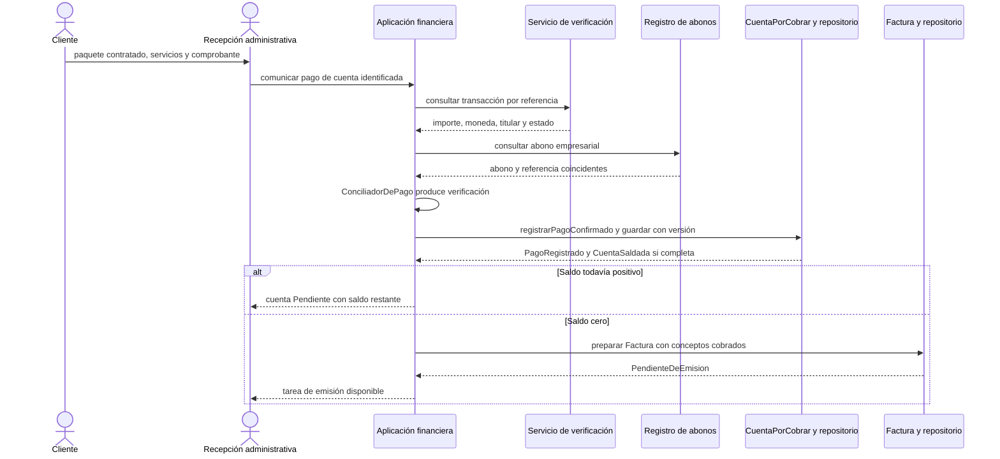

## 10.3 Devolución de exceso

La devolución comienza con la diferencia conservada entre el importe recibido y el aplicado. Dirección revisa el exceso y autoriza su salida sobre el movimiento original. Recepción adquiere una ejecución identificada antes de solicitar la devolución externa y conserva la evidencia del abono de salida. El saldo de la cuenta y las líneas de una factura emitida permanecen asociados a los servicios cobrados, no al exceso devuelto.

```text
GestionarDevolucionService.ejecutar(cuentaId, devolucionId, actor):
  cargar cuenta, exceso y autorizacion de Direccion
  invocar aprobarDevolucion si todavia corresponde; guardar
  si ya Devuelta con resultado identico: devolver SinEfecto
  si EnProceso o Incierta:
    consultar resultado externo
    si salida confirmada: confirmarDevolucion, guardar y devolver
    si resultado no determinable: conservar Incierta y devolver RequiereRevision
    si no salida y cese acreditados: registrarNoEjecucionDevolucion y guardar Aprobada
  si Aprobada: adquirirDevolucion y guardar con version; confirmar commit
  solo el ganador entrega una solicitud con devolucionId estable
  si resultado incierto: conservar Incierta y responsable
  si salida verificada: confirmarDevolucion y guardar resultado
```

El identificador de devolución se conserva entre consultas e intentos recuperados. Una respuesta perdida no demuestra que el dinero permaneció en Nodo. Si no puede determinarse el resultado, la función administrativa conserva la revisión abierta y no adquiere una segunda ejecución. La confirmación posterior idéntica registra una sola salida y permite cerrar la entidad interna.

## 10.4 Preparación, emisión y envío de Factura

```text
EmitirFacturaService.ejecutar(cuentaId, datosFacturacion, actor):
  autorizar responsable de emision; consultar cuenta y conceptos cerrados
  exigir cuenta Saldada y pagos verificados que cubren su total
  obtener o crear Factura por clave unica cuentaId y tipoDocumento
  guardar PendienteDeEmision con lineas y total inmutables
  si ya Emitida o Enviada: devolver referencia existente
  si hay intento activo o incierto:
    consultar resultado externo
    si emision confirmada: confirmarEmision, guardar y devolver referencia
    si resultado no determinable: conservar intento y devolver RequiereRevision
    si no emision y cese acreditados: registrarNoEmision y guardar
  si no hay ejecucion activa: adquirirEmision y confirmar guardado
  Recepcion opera el mecanismo de emision con identidad del intento
  si resultado confirmado: Factura.confirmarEmision y guardar
  si incierto: mantener pendiente e identidad del intento

EnviarFacturaService.ejecutar(facturaId, destinatario, actor):
  cargar factura Emitida o Enviada; autorizar destinatario
  solicitar envio con envioId estable
  si enviado con evidencia: Factura.confirmarEnvio y guardar
  si fallo: conservar emision y detalle del intento; no reemitir
```

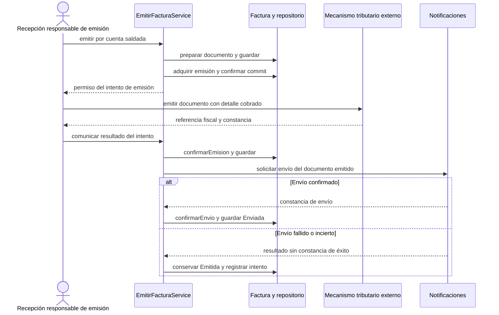

La factura no se crea por el mero comprobante que comunica el cliente. La preparación requiere que los pagos verificados hayan completado la obligación, y la emisión exige además un resultado externo correlacionado. El envío ocurre después y puede recuperarse sin emitir un documento nuevo. La misma identidad interna permite consultar la factura durante todos esos pasos, aunque todavía no exista número fiscal.

## 10.5 Solicitud de suspensión o rehabilitación

```text
SuspenderAccesoService.ejecutar(accesoId, actor):
  autorizar Recepcion; cargar acceso, version y contexto
  consultar situacion financiera completa y avisos de obligaciones bloqueantes
  evaluacion = evaluarSuspension(contexto, situacion, avisos, reloj.ahora())
  acceso.solicitarSuspension(evaluacion, reloj.ahora())
  guardar operacion Solicitada, estado y evento en transaccion local
  disponer tarea para completar operacion, sin entregar permiso fisico

RestablecerAccesoService.ejecutar(accesoId, actor):
  autorizar Recepcion; cargar acceso y contexto actual
  consultar situacion financiera completa y derecho vigente
  evaluacion = evaluarRestablecimiento(contexto, situacion, plan, politica, reloj.ahora())
  acceso.solicitarRestablecimiento(evaluacion, permisoRecepcion, reloj.ahora())
  guardar Alta Solicitada, estado y evento
  disponer tarea para completar operacion, sin afirmar alta realizada
```

La evaluación de suspensión calcula el plazo de cada obligación y el margen de su aviso. No utiliza automáticamente la fecha de renovación para todos los cargos ni suspende a un visitante por una cuenta ajena. La rehabilitación comprueba las obligaciones exigibles del pagador que cubre el derecho y la vigencia actual del plan. El horario de configuración puede diferir del horario de ingreso, por lo que el controlador debe evaluar cada entrada concreta.

## 10.6 Completar una actuación adquirida

```text
CompletarOperacionPendienteService.ejecutar(accesoId, operacionId, actor):
  autorizar actor y cargar raiz con historial y version
  obtener evidencia opcional por OperacionHuellaPort y validar correlacion
  si terminal identico: devolver SinEfecto
  si evidencia antigua contradictoria:
    raiz.registrarEvidenciaContradictoria; guardar congelacion
    exigir cese de ejecutores e inspeccion actual antes de reconciliarResultadoFisico
  si EnEjecucion o ResultadoIncierto:
    consultar al mismo ejecutor, sin reenviar
    si resultado no determinable: guardar ResultadoIncierto; devolver RequiereRevision
    si no efecto y cese acreditados: registrarNoEjecucion; guardar Solicitada
    si efecto real: ir a ConfirmarResultado
  si Solicitada:
    reconsultar datos, construir contexto y reevaluar accion
    si motivo invalidado y no efecto acreditado: cancelar por raiz; guardar y devolver
    si NoEvaluable: mantener revision y devolver RequiereRevision sin permiso fisico
    adquirirEjecucion(operacionId, ejecutorId, reloj.ahora())
    guardar con versionEsperada y confirmar commit
    si conflicto: recargar y devolver Conflicto sin entregar esa orden
    recargar contexto ganador, reconsultar y reevaluar antes del acto
    si cambia motivo: acreditar cese sin efecto; cancelar o mantener revision; guardar y devolver
    entregar una tarea al ejecutor adquirido
    si resultado incierto: guardar ResultadoIncierto y devolver RequiereRevision sin reasignar
  ConfirmarResultado:
    recargar raiz y validar evidencia de tipo, intento, ejecutor y dispositivo
    si baja ordinaria real: confirmarSuspension y guardar
    si alta real: consultar situacion y plan; evaluarRestablecimiento con contexto nuevo
      si favorable: confirmarRestablecimiento y guardar
      si desfavorable o NoEvaluable: registrarAltaNoElegible y guardar
    si baja correctiva real: completarRetiroCorrectivo y guardar
    si alta no elegible cerrada: solicitarRetiroCorrectivo con otra identidad y guardar
    completar esa nueva operacion mediante adquisicion previa
```

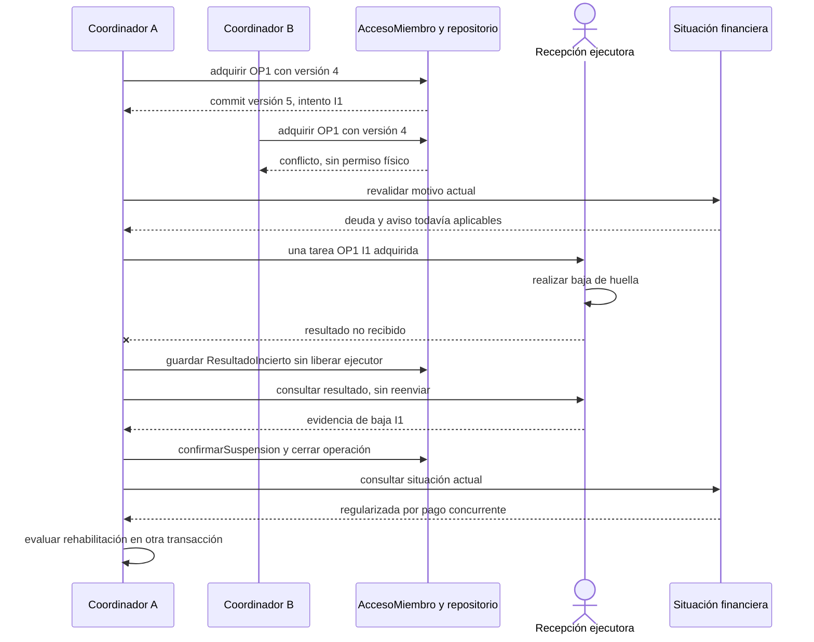

Un conflicto después del efecto solo permite recuperar su registro o reconciliar el resultado. Nunca autoriza repetir la actuación que pudo haber ocurrido. La cancelación ordinaria requiere acreditar que no hubo efecto ni operador todavía autorizado para actuar. La evidencia antigua incompatible exige conservar el historial, cesar las autorizaciones anteriores e inspeccionar el estado actual antes de normalizar la situación.

## 10.7 Escenarios de funcionamiento y respuesta

| Situación | Respuesta definida | Estado o información que se conserva |
| --- | --- | --- |
| Plan de equipo consume horas adicionales | Crear conceptos del exceso con descuento comprometido | Pagador titular, consumo y precioVersion |
| Cancelación de sala a tres horas | Cobrar franja completa comunicada por Reservas | Identidad de reserva y motivo del cargo |
| Depósito BOB 200 de evento BOB 1.000 | Liquidar depósito y luego remanente BOB 800 | Dos tramos cuyo total no duplica el anticipo |
| Tarifa cambia después de contratar | Conservar precio ya comprometido | Conceptos y líneas inmutables |
| Comprobante sin abono empresarial | Mantener verificación sin aplicar | Saldo original y discrepancia |
| Pago BOB 200 sobre BOB 480 | Aplicar BOB 200 y conservar BOB 280 | Pendiente, sin factura de cuenta completada |
| Segundo pago BOB 300 | Aplicar BOB 280 y conservar exceso BOB 20 | Saldada y devolución independiente |
| Misma referencia repetida | Responder YaAplicado antes de comparar saldo | Una aplicación y datos originales |
| Referencia utilizada en otra cuenta | Rechazar asociación incompatible | Conflicto auditable sin segunda imputación |
| Factura pedida antes de completar pago | No preparar documento definitivo | Cuenta pendiente y motivo de rechazo |
| Emisión externa incierta | Consultar intento antes de otra emisión | PendienteDeEmision e intento conservado |
| Envío de factura falla | Reintentar envío sin reemitir | Emitida y registro del envío |
| Antes del quinto día desde vencimiento | No solicitar suspensión por esa obligación | Habilitado y seguimiento de cobro |
| Quinto día exacto y aviso suficiente | Solicitar suspensión si persiste motivo | SuspensionPendiente, todavía sin baja confirmada |
| Aviso tardío o fallido | Esperar envío exitoso y veinticuatro horas | Sin permiso físico de corte |
| Pago antes de baja no ejecutada | Cancelar con evidencia de no efecto y cese | Operación Cancelada y Habilitado |
| Pago durante baja real | Confirmar hecho y evaluar alta posterior | Suspendido con evidencia y coordinación de rehabilitación |
| Alta real pierde elegibilidad | Cerrar alta sin habilitar y crear baja correctiva | Presente e incidencia hasta ausencia confirmada |
| Dos coordinadores intentan actuar | Solo el ganador adquirido entrega tarea | Un ejecutor; perdedor recarga |
| Plan normal fuera de horario | Denegar entrada aunque exista registro | Evaluación Ingresar desfavorable |
| Plan continuo vigente y regularizado | Evaluar entrada sin restricción de franja normal | Permiso condicionado a estado físico confiable |
| Visitante de evento | Consultar derecho temporal del evento | Identidad y vigencia del derecho, sin crear renovación |

## 10.8 Evaluación de una entrada

El caso de uso distingue el derecho de un miembro del derecho temporal de una contratación. El primero utiliza AccesoMiembro y las obligaciones exigibles de su pagador dentro del alcance definido. El segundo consulta un derecho confirmado por Reservas y disponibilidad o Agenda de eventos y no crea una membresía. La apertura temporal es supervisada por Recepción, mientras la apertura ordinaria exige que el controlador respete la evaluación vigente.

```text
EvaluarIngresoService.ejecutar(sujetoId, derechoId, momento):
  autenticar solicitante y consultar derecho por contrato autorizado
  si derecho de miembro:
    cargar AccesoMiembro y contexto actual
    consultar situacion financiera completa y plan vigente
    devolver evaluarIngreso(contexto, situacion, plan, momento)
  si derecho temporal:
    consultar confirmacion del subdominio responsable
    devolver evaluarDerechoTemporal(derechoConfirmado, momento)
  si derecho ausente, incompleto o ajeno: devolver NoEvaluable
```

---

<a id="capitulo-11"></a>

# 11. Decisiones, políticas operativas y riesgos

## 11.1 Leyenda de las matrices de decisiones

La notación se concentra en las matrices de decisiones y no forma parte de nombres, firmas o métodos. Su función es distinguir las condiciones del negocio, las elecciones de arquitectura y los parámetros que requieren una configuración concreta. Un supuesto adoptado tiene una respuesta definida en las operaciones del modelo y no se presenta como una capacidad instalada de un proveedor. Las políticas se mantienen iguales en estados, diagramas, contratos y ejemplos para evitar interpretaciones diferentes de la misma regla.

| Notación | Significado | Aplicación |
| --- | --- | --- |
| [C] | Condición del caso de Nodo | Paquetes, consumos, precios comprometidos y ejemplo de cinco días |
| [E] | Información operativa incorporada | Actuación manual de Recepción y registro de huella |
| [D] | Estructura conceptual del docente | Dominio y ocho subdominios con sus nombres y clasificación |
| [G] | Decisión de organización del modelo | Fronteras, nombres y distribución de responsabilidades adoptados |
| [A] | Supuesto definido para completar la solución | Horario normal concreto, aviso previo y procedimiento de devolución |
| [P] | Configuración técnica por concretar | Proveedor, formato de evidencia y capacidades del adaptador seleccionado |

## 11.2 Decisiones de arquitectura

| Registro | Notación | Decisión y consecuencia |
| --- | --- | --- |
| ADR01 | [G] | Dos *Bounded Contexts*: Facturación y Cobros protege obligaciones, pagos y documentos. |
| ADR02 | [D/G] | Mapa de dominio y subdominios: Se conservan los ocho subdominios y la clasificación del docente. |
| ADR03 | [G] | Estados con nombres uniformes: Los estados se expresan con nombres como Pendiente, Saldada, Habilitado y SuspensionPendiente. |
| ADR04 | [G/A] | Factura interna y emisión externa: El seguimiento fiscal deja de ser solamente una referencia auxiliar. |
| ADR05 | [E/G] | Confirmación del registro de huella: Recepción da de baja o vuelve a registrar la huella manualmente. |
| ADR06 | [G] | Monolito modular y transacciones locales: Los dos contextos pueden residir en una aplicación sin compartir sus entidades. |
| ADR07 | [G] | *Anti-Corruption Layer* financiera: Control de Acceso consume una situación financiera pública y la convierte en SituacionPago. |
| ADR08 | [G] | Reconocer referencia antes de comparar saldo: El movimiento aplicado conserva referencia, importe recibido y moneda originales. |
| ADR09 | [G] | Unicidad entre objetos financieros: El módulo mantiene asociación única entre origen y referencia de pago y la cuenta correspondiente. |
| ADR10 | [G/A] | Conservar hechos físicos y compensar: Si se paga durante una baja real, se confirma esa baja y se evalúa rehabilitación aparte. |
| ADR11 | [C/A] | Cinco días y aviso previo: El modelo vigente adopta cinco días calendario desde vencimiento de la obligación bloqueante. |
| ADR12 | [G] | Patrones por responsabilidad del contrato: La relación con los proveedores se elige por el modelo que gobierna cada uno. |
| ADR13 | [G] | Entidad interna de operación y cierre: OperacionRegistroHuella conserva identidad, tipo, intentos, responsable y estado. |
| ADR14 | [G] | Adquisición persistida antes del efecto: La asignación de ejecutor se guarda con versión antes de entregar una tarea externa. |
| ADR15 | [G/A] | Evaluación por acción y horario: EvaluadorDeIngreso recibe valores y produce una evaluación identificada para Suspender, Restablecer o Ingresar. |
| ADR16 | [G] | Notificaciones como proveedor del servicio: Notificaciones controla el contrato de entrega y los modelos lo consumen. |
| ADR17 | [C/G] | Facturación de todos los servicios: La renovación es una operación entre los servicios cobrables de Nodo. |
| ADR18 | [C/A] | Verificación, parcialidad y sobrepago: El cliente puede comunicar un comprobante y la empresa contrasta transacción y abono. |
| ADR19 | [G/A] | Tres *aggregate roots*: El modelo contiene CuentaPorCobrar, Factura y AccesoMiembro. |
| ADR20 | [A] | Funciones operativas e interfaces: Recepción desempeña Administración, emisión y actuación sobre la huella mediante permisos distintos. |

## 11.3 Políticas operativas adoptadas

| Aspecto | Notación | Procedimiento definido | Efecto sobre el modelo |
| --- | --- | --- | --- |
| Paquetes y derechos | [C] | Pase por día, mensual flexible, escritorio dedicado y plan de equipo; derechos incluidos identificados | Liquidar cuota y solo consumos adicionales cobrables |
| Precio comprometido | [C] | Conservar precio y descuento aceptados para cada reserva o servicio | Cambio de tarifa no altera conceptos liquidados ni facturas emitidas |
| Cancelación de sala | [C] | Sin cargo de cancelación cuando faltan al menos cuatro horas; con menos tiempo se cobra la franja completa | El cargo incluye reserva, motivo y franja |
| Depósito de evento | [C/A] | Liquidar depósito y remanente como tramos distintos del mismo importe contratado | Nunca volver a incluir el anticipo en el saldo final |
| Función administrativa | [A] | Recepción administra cargos y verifica pagos con permisos identificados | No se exige inventar otra persona para Administración |
| Evidencia de pago | [C/A] | Comprobante comunicado opcional más transacción externa y abono empresarial coincidentes | Solo PagoVerificado habilita la aplicación |
| Parcialidad | [A] | Aceptar abonos verificados parciales; mantener Pendiente hasta cubrir el total | No preparar Factura definitiva antes de completar esa cuenta |
| Sobrepago | [A] | Identificar exceso, verificarlo, obtener autorización de Dirección y devolver con resultado confirmado | La devolución no altera el total del servicio ni produce saldo negativo |
| Factura | [G/A] | Recepción prepara después del pago completo, emite por mecanismo externo y registra envío | Factura tiene identidad propia y referencia fiscal confirmada |
| Tolerancia | [C/A] | Cinco días calendario desde vencimiento de obligación bloqueante | No aplicar una semana de siete días como otra regla simultánea |
| Aviso previo | [E/A] | Aviso exitoso que identifica obligaciones, con veinticuatro horas mínimas antes del corte | Fecha efectiva igual al máximo entre ambos límites |
| Horario normal | [A] | Lunes a viernes de 08:00 a 18:00, fin excluido, en America/La_Paz | Parámetro del derecho; planes continuos utilizan acceso 24/7 |
| Rehabilitación ordinaria | [E/A] | Recepción opera bajo política de Dirección cuando se regularizan obligaciones exigibles y el derecho está vigente | No requiere una nueva autorización excepcional para cada pago ordinario |
| Alta fuera del horario | [A] | Se puede configurar la huella fuera de franja; el ingreso sigue sujeto al derecho | No dar de baja diariamente el registro para representar el horario |
| Incertidumbre de actuación | [G] | Conservar intento y responsable; exigir cese e inspección antes de reasignar | No liberar por mero vencimiento de tiempo |
| Datos financieros recientes | [A] | Reconsulta en cada fase y antigüedad máxima de treinta segundos al decidir | Un error o alcance incompleto produce NoEvaluable |
| Plan de equipo | [C/A] | Titular pagador identificado y derechos de cada beneficiario vinculados explícitamente | La afectación de acceso se aplica a los sujetos cubiertos por la obligación |
| Derecho temporal | [C/A] | Reservas o Agenda de eventos confirman sujeto, intervalo y condiciones económicas | No tratar al visitante como una membresía en renovación |

Las políticas anteriores completan el funcionamiento de la solución sin dejar indeterminado quién actúa o qué resultado se espera. Los valores asumidos se configuran en la política correspondiente y conservan una versión. Un cambio de horario, plazo o permiso exige reevaluar las operaciones que todavía no se ejecutaron. El cambio no elimina movimientos financieros ni hechos físicos que ya fueron confirmados.

## 11.4 Configuración de las integraciones

| Elemento | Notación | Dato que debe configurarse | Condición de aceptación del adaptador |
| --- | --- | --- | --- |
| Verificación de pagos | [P] | Proveedor, autenticación, estados y correspondencia con abono | Poder consultar una transacción y distinguir autorización de abono confirmado |
| Registro empresarial | [P] | Identificador del abono y mecanismo de conciliación | Relacionar inequívocamente el ingreso con el movimiento y la cuenta |
| Emisión tributaria | [P] | Portal o conector autorizado, tipo de documento y referencia | Consultar resultado por identidad y no duplicar emisión tras incertidumbre |
| Controlador de puerta | [P] | Dispositivo, consulta de estado y aplicación de horario | Respetar derechos de apertura y permitir evidencia de alta, baja o inspección |
| Notificaciones | [P] | Canal, destinatario autorizado y constancia de envío | Diferenciar solicitud, entrega confirmada y resultado incierto |

## 11.5 Riesgos y recuperación

| Riesgo | Consecuencia | Respuesta definida |
| --- | --- | --- |
| Cobrar de nuevo un consumo recibido dos veces | Duplicación de obligación | Unicidad del origen de cargo y conservación del resultado |
| Tomar comprobante aislado como abono | Reducir saldo sin dinero confirmado | Conciliar transacción y registro empresarial |
| Repetir movimiento en dos cuentas | Doble aplicación económica | Asociación única y guardado atómico del módulo |
| Incluir depósito otra vez en evento | Cobrar más que el contrato | Tramos identificados y remanente calculado con depósitos previos |
| Emitir otra factura tras perder respuesta | Duplicación del documento | Intento adquirido y consulta externa antes de repetir |
| Reenviar devolución incierta | Doble salida de dinero | Identidad estable, un responsable y conciliación de salida |
| Dos operadores actúan sobre la huella | Resultado físico contradictorio | Adquisición persistida antes de entregar permiso |
| Alta real pierde elegibilidad | Registro presente sin derecho reconocido | Cerrar alta y ejecutar otra baja correctiva con evidencia |
| Estado histórico interpretado como estado actual | Permiso incorrecto durante una incidencia | Mostrar observación e impedir ingreso con incertidumbre bloqueante |
| Controlador no aplica horario | Ingreso fuera del derecho contratado | Exigir esa capacidad al adaptador de apertura antes de habilitar operación autónoma |
| Mensaje antiguo sobrescribe estado nuevo | Pérdida de consistencia operativa | Conservar evidencia, cesar operadores e inspeccionar situación actual |

El diseño limita el impacto de la incertidumbre conservando identidades, versiones y resultados. Las transacciones locales protegen lo que debe cambiar junto y los contratos coordinan los efectos externos. Ningún mecanismo de mensajería convierte un movimiento bancario, un comprobante fiscal y una puerta en una transacción global. La recuperación privilegia el hecho verificable y conserva una revisión explícita cuando todavía no puede acreditarse el resultado.

---

<a id="capitulo-12"></a>

# 12. Modelo integrado y anexos operativos

## 12.1 Ejemplo de liquidación de un paquete

Un cliente contrata un paquete mensual cuya cuota ilustrativa es BOB 400. Durante el período utiliza horas de sala que exceden el derecho incluido y generan un concepto neto de BOB 80 con el descuento comprometido. La cuenta reúne ambos conceptos por BOB 480 y conserva sus identidades de origen. Los importes son ejemplos de funcionamiento y no un catálogo real de precios de Nodo.

| Concepto | Cantidad y condición | Neto |
| --- | --- | ---: |
| Cuota del paquete mensual | Período identificado y cuota pactada | BOB 400 |
| Horas adicionales | Exceso confirmado y descuento del plan ya aplicado | BOB 80 |
| Total de CuentaPorCobrar | Suma de conceptos liquidados | BOB 480 |

El cliente comunica primero un movimiento de BOB 200. Después de contrastar la transacción y el abono, la aplicación deja BOB 280 pendientes. Un segundo movimiento verificado de BOB 300 aplica BOB 280 y registra un exceso de BOB 20. La factura se prepara por BOB 480 y la devolución se tramita por BOB 20, conservando ambas referencias de pago.

| Magnitud | Igualdad que debe conservarse | Resultado |
| --- | --- | ---: |
| Total recibido | Primer movimiento más segundo movimiento | BOB 500 |
| Total aplicado a servicios | Cuota y horas adicionales | BOB 480 |
| Exceso identificado | Recibido menos aplicado | BOB 20 |
| Saldo pendiente | Total contratado menos aplicado | BOB 0 |
| Total de Factura | Suma de conceptos cobrados, sin exceso | BOB 480 |

## 12.2 Ejemplo de evento con depósito

Un evento tiene un importe contratado ilustrativo de BOB 1.000. Su depósito requerido es BOB 200 y se liquida como un tramo independiente. Después de verificar ese pago, la factura del depósito conserva el evento y el tramo que documenta. El remanente original es BOB 800 y no vuelve a incorporar los BOB 200 que ya se cobraron.

Si el cliente solicita posteriormente equipo audiovisual por BOB 100, el cargo adicional conserva su autorización y origen. Cuando todavía no se creó la cuenta del remanente, esta puede nacer con BOB 800 de saldo contratado y BOB 100 de servicio adicional. Si la cuenta anterior ya estaba cerrada, el adicional se liquida en otra cuenta identificada. En ambos casos, el total cobrado por el evento completo es BOB 1.100 y cada factura documenta únicamente su cuenta.

## 12.3 Ejemplo de deuda y operación de acceso

Una obligación bloqueante vence el 1 de noviembre a las 09:00 y el aviso se entrega el 2 de noviembre a las 10:00. El plazo de cinco días termina el 6 de noviembre a las 09:00 y el margen del aviso ya se cumplió. Si persiste el impago, la evaluación permite solicitar la suspensión desde ese instante. El estado pasa a SuspensionPendiente, pero la observación física solo pasa a Ausente después de la baja confirmada.

Si el cliente paga antes de la actuación, Recepción acredita no ejecución y cese del permiso anterior antes de cancelar. Si el pago coincide con una baja que ya ocurrió, el resultado real se registra y se evalúa el alta en otra operación. Un alta confirmada exige que las obligaciones exigibles estén regularizadas y el plan siga vigente. El ingreso posterior mantiene el horario del paquete aunque la huella haya quedado correctamente registrada.

## 12.4 Inventario de componentes

| Componente | Cantidad y nombres | Frontera o función |
| --- | --- | --- |
| *Bounded Contexts* desarrollados | Facturación y Cobros; Control de Acceso | Dos modelos con contratos públicos |
| *Aggregate roots* | CuentaPorCobrar; Factura; AccesoMiembro | Tres unidades de consistencia |
| *Repositories* | Una interfaz por cada raíz | Cargar y guardar frontera completa con versión |
| *Domain Services* | CalculoDeCobro; ConciliadorDePago; EvaluadorDeIngreso | Cálculos y decisiones puras sobre valores |
| *Factory* explícita | CuentaPorCobrarFactory | Componer obligación liquidada válida |
| Casos de uso | CU01 a CU09 | Liquidación, pagos, devolución, factura, acceso y coordinación |
| Invariantes | I01 a I16 | Consistencia económica, documental y física |

## 12.5 Anexos de consulta

Los anexos permiten revisar contratos, reglas y nombres sin recorrer el documento completo. Cada uno desarrolla una vista del mismo modelo y conserva los identificadores utilizados en los capítulos. El documento maestro incorpora los capítulos íntegros y ajusta sus enlaces a la ubicación de lectura. Un cambio en una política debe actualizar sus consumidores y la versión consolidada para que no existan respuestas incompatibles.

- [Catálogo de eventos y contratos](02_Artefactos_Complementarios/01_Catalogo_de_Eventos_y_Contratos.md).
- [Matriz de reglas e invariantes](02_Artefactos_Complementarios/02_Matriz_de_Reglas_Invariantes_y_Pruebas_Propuestas.md).
- [Decisiones de arquitectura](02_Artefactos_Complementarios/03_Decisiones_Arquitectonicas_ADR.md).
- [Glosario por subdominio](02_Artefactos_Complementarios/04_Glosario_Canonico_por_Contexto.md).
- [Guía de diagramas](02_Artefactos_Complementarios/05_Guia_de_Diagramas_y_Leyenda.md).
- [Evolución del modelo](02_Artefactos_Complementarios/06_Historial_de_Versiones_y_Contradicciones.md).
- [Especificación técnica de interfaces y persistencia](04_Prototipo_NO_Implementado/ESPECIFICACION_FUTURA_PROTOTIPO_Y_PRUEBAS.md).
