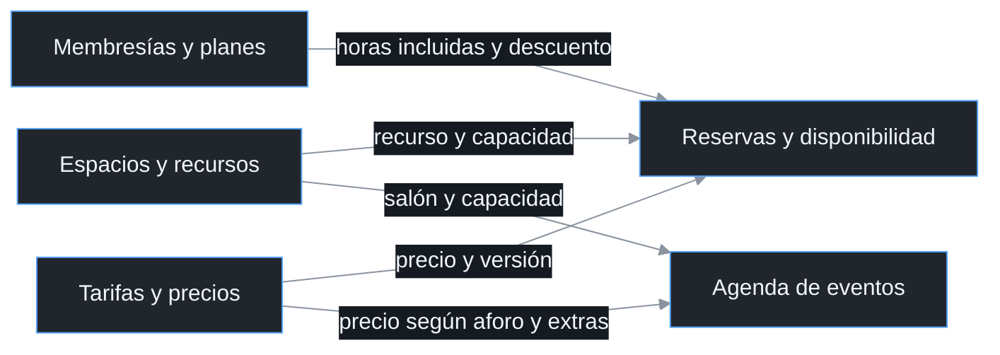
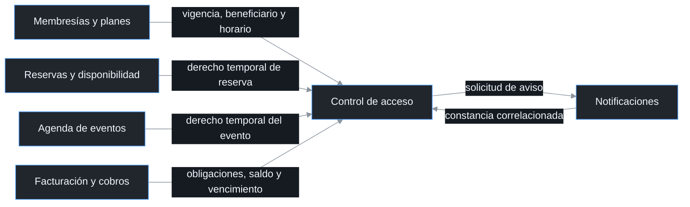

# Subdominios y fronteras de Nodo

Consulta temática del [documento principal](00_ENTREGABLE_COMPLETO.md), con los diagramas, conceptos y reglas correspondientes.

### 2.2 Subdominios y flujo de datos

El dominio de Nodo comprende la gestión de espacios, personas y eventos. Según los subdominios planteados, Reservas y disponibilidad concentra la coordinación del uso de espacios y recibe las condiciones de los planes, recursos y precios. Facturación y Cobros recibe los servicios valorizados y genera obligaciones económicas, mientras Control de Acceso combina derechos y situación de pago. Los intercambios se separan en contratación, liquidación y acceso para seguir el recorrido de cada dato sin superponer todas las relaciones.

**Figura 2.2a. Condiciones para contratar espacios y eventos.**

**Figura 2.2b. Origen de los conceptos económicos.**

**Figura 2.2c. Derechos, situación económica y avisos de acceso.**

| Subdominio | Clasificación | Responsabilidad y dato principal |
| --- | --- | --- |
| Reservas y disponibilidad | *Core* | Evitar solapes, mantener disponibilidad y comunicar reservas, consumos y cancelaciones |
| Membresías y planes | *Supporting* | Definir paquete, derechos, cuota, titular pagador, miembros cubiertos y vigencia |
| Agenda de eventos | *Supporting* | Gestionar aprobación, depósito requerido, contratación de extras y derechos temporales |
| Tarifas y precios | *Supporting* | Proporcionar precios y descuentos con vigencia y versión |
| Espacios y recursos | *Supporting* | Mantener recursos, capacidades y características operativas |
| Facturación y cobros | *Generic* | Liquidar cargos, conciliar pagos, devolver excesos y emitir facturas |
| Control de acceso | *Generic* | Evaluar ingreso y coordinar operaciones confirmadas sobre la huella |
| Notificaciones | *Generic* transversal | Entregar mensajes y devolver resultados de envío correlacionados |

Conservo Reservas y disponibilidad como *core* porque coordina el uso de recursos limitados y permite ofrecer una disponibilidad confiable. Los planes, los precios, los eventos y los recursos sostienen esa capacidad con reglas propias. Facturación y cobros y Control de acceso se clasifican como *generic* porque sus capacidades pueden apoyarse en soluciones estándar, aunque su integración requiere proteger las condiciones económicas y los derechos de Nodo. La clasificación expresa prioridad estratégica y no elimina las invariantes ni la necesidad de modelar las excepciones de cada subdominio.

Reservas y disponibilidad conserva la responsabilidad de impedir reservas solapadas y respetar los quince minutos de limpieza. Facturación y Cobros recibe el resultado económico de una reserva o cancelación, sin decidir disponibilidad. Control de Acceso recibe derechos y obligaciones, sin calcular tarifas ni editar el plan. Notificaciones entrega mensajes, pero la obligación de avisar antes de una suspensión sigue perteneciendo a la política de acceso.

### 5.1 Fronteras de los modelos

Facturación y Cobros y Control de Acceso representan dos *Bounded Contexts* con lenguaje y reglas propios. El primero protege obligaciones, movimientos de dinero, devoluciones y documentos cobrados. El segundo protege derechos de ingreso, restricciones horarias y actuaciones sobre la huella. La coordinación se apoya en contratos de información y no en compartir las entidades de ambos modelos.

| Señal de frontera | Facturación y Cobros | Control de Acceso | Consecuencia |
| --- | --- | --- | --- |
| Significado | Cuenta saldada y factura emitida | Acceso habilitado y baja confirmada | El mismo término confirmado debe indicar su objeto |
| Reglas | Moneda, saldo, referencia y total facturado | Vigencia, horario, aviso y resultado físico | Cada raíz protege invariantes de su modelo |
| Responsabilidad | Administración liquida, concilia y emite; Dirección autoriza excepciones económicas | Recepción configura huella bajo política de Dirección | Los permisos se asignan por responsabilidad y no por acceso indistinto al modelo |
| Cambio de proceso | Se completa el pago y se prepara el documento | Se reevalúa el derecho y se completa una operación física | Los eventos coordinan transacciones separadas |
| Recuperación | Conciliar abono, evitar otra aplicación o devolución | Consultar ejecutor, cesar autorización e inspeccionar | El tratamiento de incertidumbre conserva el significado del efecto |

Un único contexto con varias raíces sería técnicamente posible. Elijo dos contextos porque las obligaciones económicas y las actuaciones sobre la huella tienen significados, responsables y formas de recuperación diferentes. Prefiero un monolito modular porque permite mantener ambos modelos en una aplicación, separar sus interfaces y conservar la persistencia lógica de cada módulo. Las llamadas al proveedor de pagos, al mecanismo fiscal y al lector permanecen fuera de la transacción local de cada raíz.
