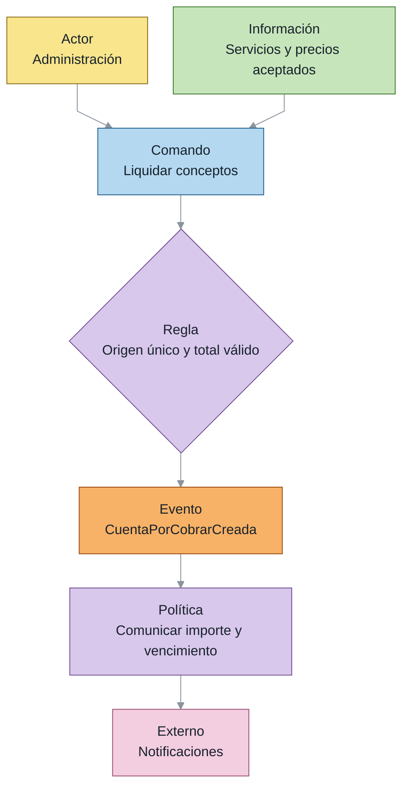
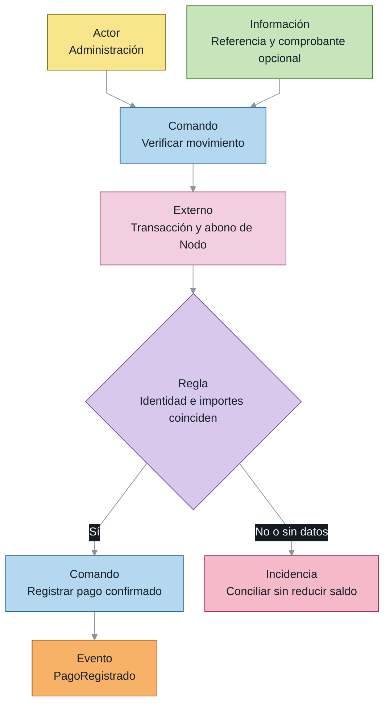
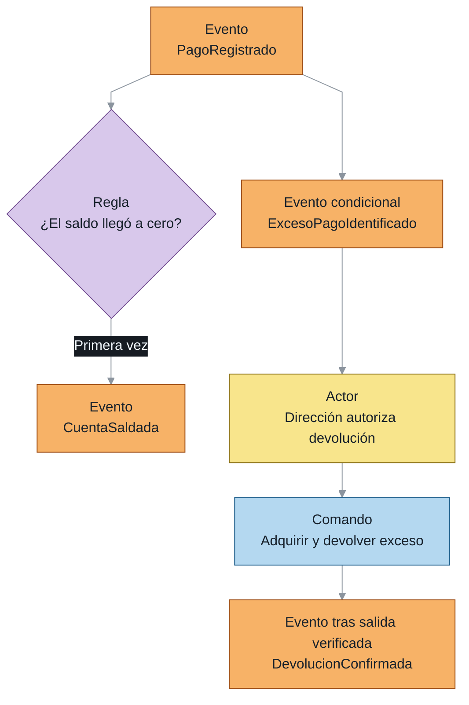
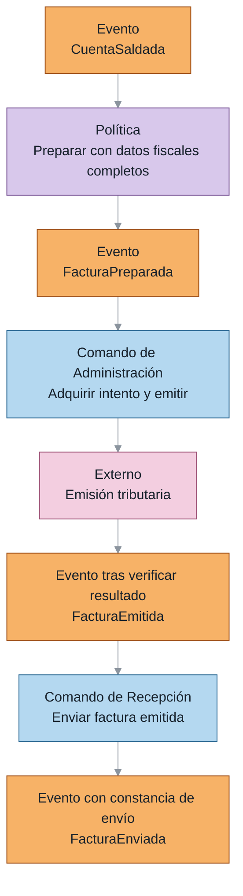
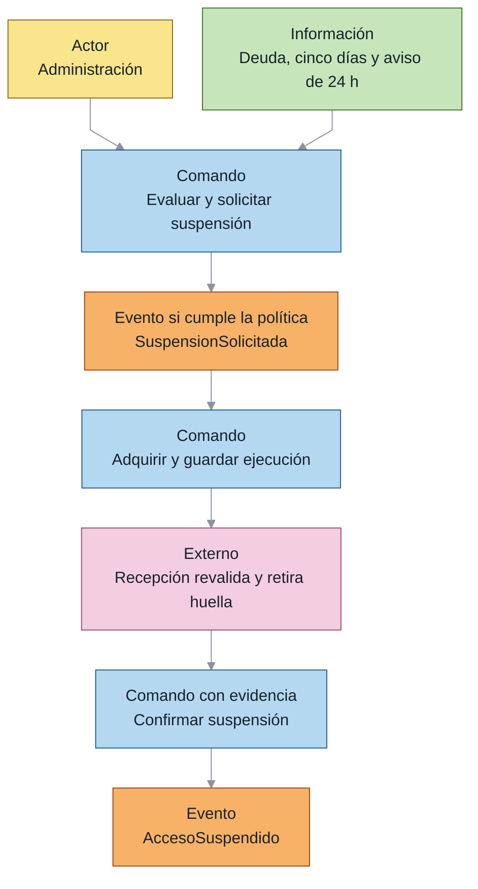
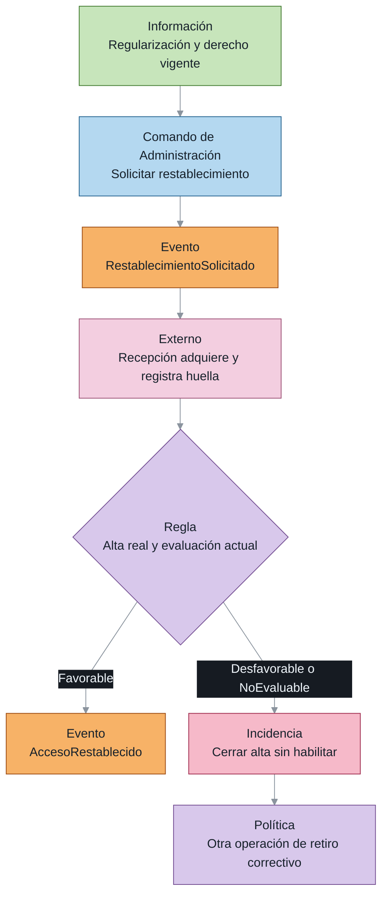
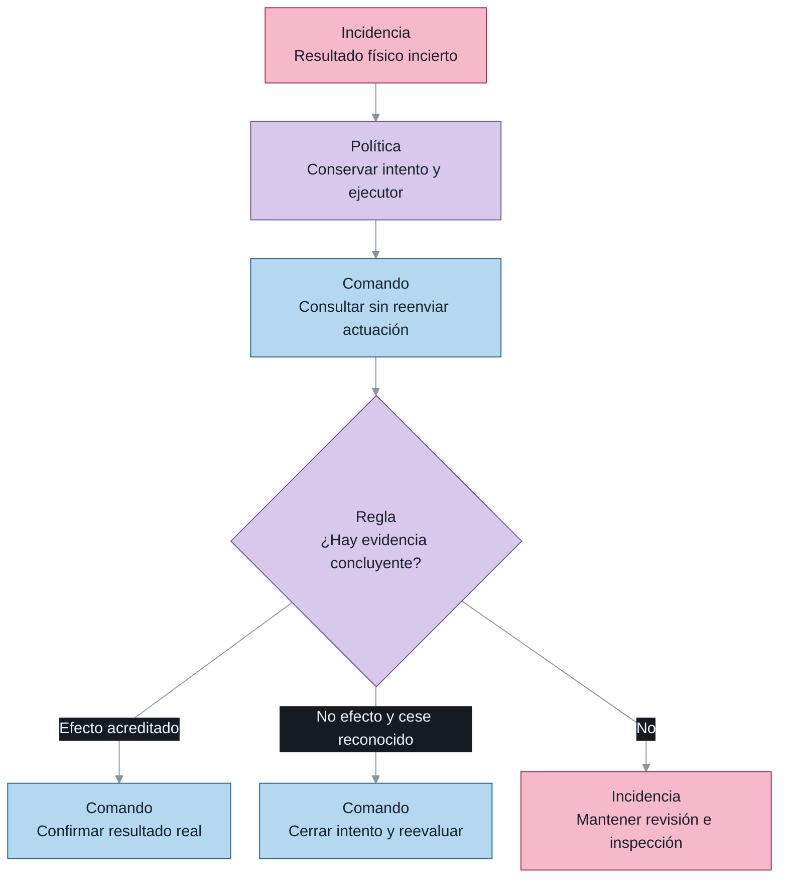

# EventStorming de cobros y acceso

Consulta temática del [documento principal](00_ENTREGABLE_COMPLETO.md), con los diagramas, conceptos y reglas correspondientes.

### 4.2 *EventStorming* de facturación y cobros

**Figura 4.2a. Liquidación de los servicios contratados.**

**Figura 4.2b. Verificación y aplicación del pago.**

**Figura 4.2c. Saldo y devolución de un exceso.**

**Figura 4.2d. Preparación, emisión y entrega de la factura.**

La cuenta admite cargos de todos los servicios del alcance y no depende de que el origen sea una renovación. La verificación compara el comprobante comunicado con el movimiento externo y el abono de la empresa. La parte que excede la obligación conserva un expediente de devolución y no aumenta el total facturado. Una respuesta fiscal incierta impide confirmar la emisión y exige consultar el resultado antes de repetir la actuación.

### 4.3 *EventStorming* de suspensión y rehabilitación

**Figura 4.3a. Solicitud y confirmación de suspensión.**

**Figura 4.3b. Rehabilitación y corrección de un alta.**

**Figura 4.3c. Recuperación de una actuación incierta.**

Las operaciones pendientes se completan utilizando la misma identidad y no vuelven a solicitarse desde un estado incompatible. La adquisición se guarda antes de entregar la tarea y solo el ganador puede actuar. Cuando el resultado es incierto, la consulta y la inspección sustituyen al reenvío automático. Si el alta ya ocurrió y se perdió elegibilidad, el sistema conserva ese hecho, cierra el alta y crea otra operación para la baja correctiva.
