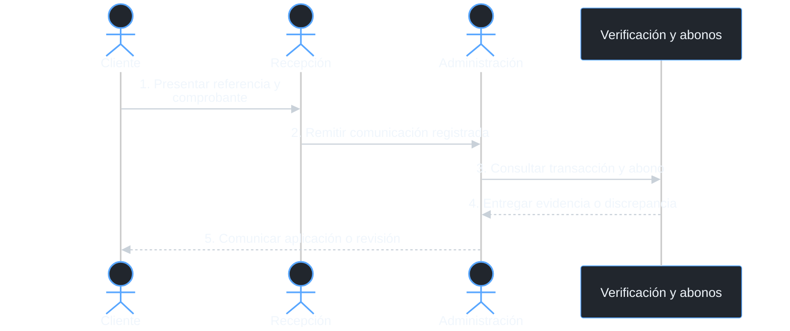
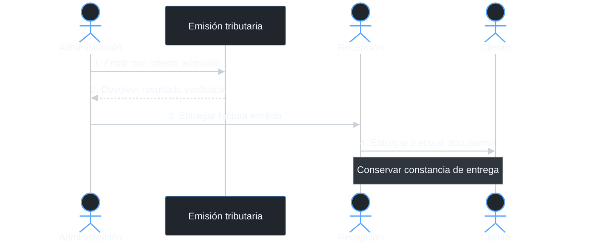
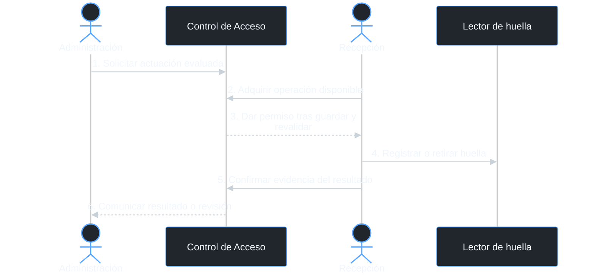

# Historias de dominio y responsabilidades

Consulta temática del [documento principal](00_ENTREGABLE_COMPLETO.md), con los diagramas, conceptos y reglas correspondientes.

### 2.4 Responsabilidades y procedimiento

Administración gestiona la información económica, concilia los movimientos y emite las facturas. Recepción atiende al cliente, registra las comunicaciones de pago, entrega los documentos emitidos y realiza las actuaciones sobre el lector de huella. Dirección autoriza descuentos especiales, devoluciones y excepciones de acceso, además de establecer los permisos ordinarios de operación. El cliente contrata servicios, paga sus obligaciones y comunica los datos necesarios para identificar cada movimiento.

| Actor | Responsabilidad | Procedimiento | Registro |
| --- | --- | --- | --- |
| Administración | Cargos, cuentas, conciliación, devolución y emisión | Comprobar servicios y precios autorizados; liquidar conceptos; verificar transacción y abono; aplicar pagos; ejecutar devoluciones autorizadas; preparar y emitir facturas; solicitar suspensión o rehabilitación cuando corresponda | Cuenta, conceptos, referencias de pago, abonos, autorización de devolución, factura y solicitud de acceso |
| Recepción | Atención al cliente, entrega de documentos y operación física de acceso | Recibir y registrar comprobantes sin confirmar el abono; remitir incidencias económicas a Administración; entregar o enviar facturas emitidas; adquirir y ejecutar tareas de alta o baja de huella; confirmar el resultado real | Comunicación del cliente, constancia de entrega, operación, intento, ejecutor, dispositivo y evidencia |
| Dirección | Autorizaciones y política de operación | Aprobar descuentos especiales y devoluciones verificadas; autorizar el alta inicial y las excepciones; definir los permisos de Administración y Recepción | Autorización, importe o derecho afectado, alcance, vigencia y motivo |
| Cliente | Contratación y pago | Seleccionar paquete y servicios; comprobar el detalle cobrado; efectuar el pago; comunicar referencia y comprobante; recibir la factura y comunicar discrepancias | Contratación, titular pagador, movimiento informado y datos de facturación |

El cliente comunica el comprobante a Recepción o a través de un canal autorizado. Recepción registra esa comunicación y la remite a Administración, sin modificar el saldo ni acreditar por sí misma que existe un abono. Administración contrasta el movimiento con el servicio externo y el registro de ingresos de Nodo antes de aplicar el pago. Cuando la cuenta queda saldada, Administración confirma la emisión y Recepción entrega al cliente la factura correspondiente.

La coordinación del acceso comienza con la revisión económica de Administración. Una solicitud de suspensión debe identificar deuda, vencimiento y aviso, mientras una solicitud de rehabilitación exige regularización y derecho vigente. Recepción adquiere la tarea disponible, actúa sobre la cerradura y registra el resultado físico. Dirección interviene ante una excepción que exceda los permisos ordinarios, sin reemplazar la evidencia del pago o de la actuación.

---

### 4.4 *Domain Storytelling* de cobro y acceso

El cliente recibe una liquidación con el detalle de los servicios y comunica el comprobante a Recepción. Administración contrasta esa comunicación con la transacción y el abono, y decide si corresponde aplicar el movimiento. Dirección autoriza los descuentos o devoluciones que requieren una decisión especial. Después de completar el pago, Administración confirma la emisión y Recepción entrega la factura al cliente.

**Figura 4.4a. Comunicación y conciliación del movimiento.**

**Figura 4.4b. Emisión y entrega del documento.**

La solicitud de acceso utiliza la situación económica vigente y el derecho del miembro. Administración inicia la suspensión o rehabilitación que corresponda, sin declarar que la cerradura ya cambió. Recepción recibe una tarea con ejecutor e intento adquiridos, realiza la actuación y registra su evidencia. La confirmación actualiza AccesoMiembro y permite comunicar el resultado, mientras una respuesta incierta conserva la tarea para consulta e inspección.

**Figura 4.4c. Actuación de Recepción sobre la huella.**

---
