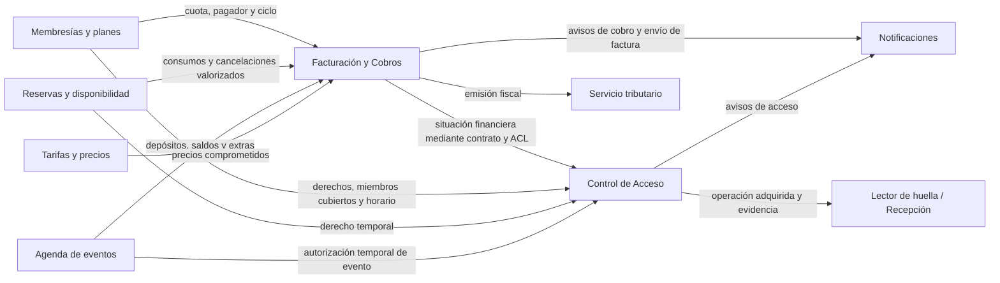

# 05. Context Map

## Propósito

Este mapa detalla las fronteras de **Facturación y Cobros** y **Control de Acceso**. Ambos *Bounded Contexts* son *Generic*. Facturación y Cobros conforma un solo contexto y contiene dos agregados principales, `CuentaPorCobrar` y `Factura`.

## Contextos y responsabilidad

### Facturación y Cobros — *Generic*

Propietario de la obligación económica, los conceptos cobrados, movimientos de pago, aplicaciones, excesos, devoluciones y factura. El agregado `CuentaPorCobrar` protege el saldo y los movimientos; el agregado `Factura` protege las líneas cobradas y el ciclo documental. Ambos agregados pertenecen al mismo lenguaje y contexto, aunque mantienen fronteras de consistencia distintas.

### Control de Acceso — *Generic*

Propietario de `AccesoMiembro`, la evaluación de elegibilidad y las operaciones de huella. Consulta la situación económica del otro contexto mediante el contrato público y una ACL del lado consumidor. No consulta directamente sus repositorios ni modifica sus agregados.

## Relaciones

| Proveedor | Consumidor | Contrato o dato | Patrón / frontera |
|---|---|---|---|
| Membresías, Reservas, Agenda de eventos y Tarifas | Facturación y Cobros | Cargo valorizado, pagador, origen, moneda y precio comprometido | El subdominio origen conserva la autoridad sobre el servicio |
| Facturación y Cobros | Control de Acceso | Situación financiera relevante, alcance, vencimientos y versiones | Contrato público y ACL; no se comparte `CuentaPorCobrar` |
| Membresías, Reservas y Agenda de eventos | Control de Acceso | Derecho, sujeto, vigencia, horario, restricciones y versión | El contexto de acceso no recalcula el derecho |
| Servicio de verificación y registro de abonos | Facturación y Cobros | Transacción y estado de abono verificables | Adaptador; comprobante comunicado no confirma el pago |
| Servicio tributario | Facturación y Cobros | Referencia fiscal, importe, moneda y resultado | Adaptador; incertidumbre no se trata como emisión confirmada |
| Notificaciones | Ambos contextos | Solicitud de envío y resultado correlacionado | Contrato de entrega; un fallo no revierte el hecho de dominio |
| Lector de huella / Recepción | Control de Acceso | Operación adquirida, resultado y evidencia identificada | Solicitud no equivale a efecto confirmado |

## Lenguaje y propiedad

- `CuentaPorCobrar`, `ConceptoCobro`, `AplicacionPago`, `DevolucionExceso`, `Factura` y `LineaFactura` pertenecen al contexto Facturación y Cobros.
- `Pendiente` y `Saldada` describen una cuenta; `PendienteDeEmision`, `Emitida` y `Enviada` describen una factura. Ambos conjuntos conviven en el mismo contexto, pero no son estados intercambiables.
- `AccesoMiembro`, `SituacionPago`, `EvaluacionAcceso` y `OperacionRegistroHuella` pertenecen al contexto Control de Acceso.
- Un importe traducido entre contextos se transporta como dato de contrato, no como una entidad de dominio mutable compartida.
- `Cliente`, pagador y miembro identifican roles diferentes; cada operación debe aclarar cuál representa.

## Reglas de integración

1. Control de Acceso no importa agregados ni repositorios financieros; consume el contrato público de situación económica.
2. Los contratos identifican su sujeto, alcance, moneda, instante y versión cuando esos datos afectan la decisión.
3. La base de datos o el proceso pueden ser compartidos, pero no se presupone una transacción global entre los dos contextos.
4. Factura y CuentaPorCobrar pertenecen al mismo contexto, pero siguen siendo agregados independientes y conservan sus invariantes propias.
