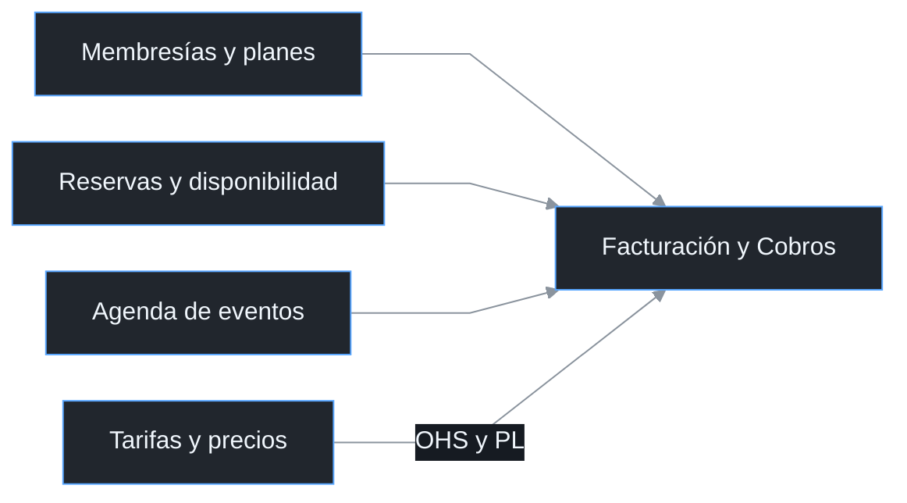
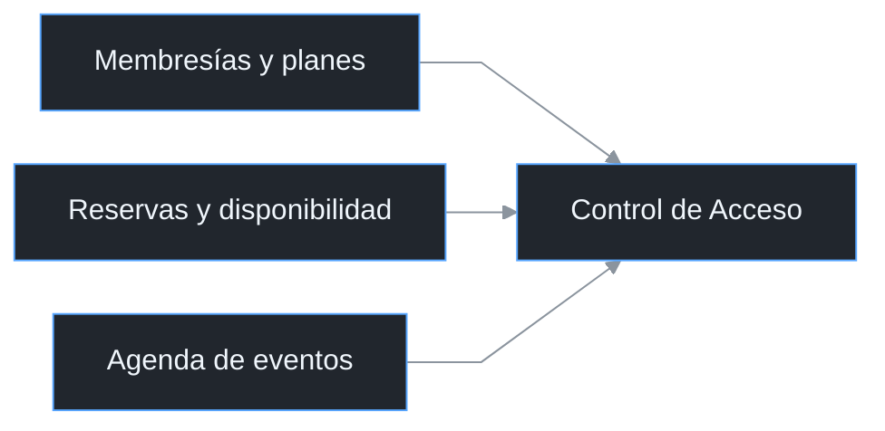
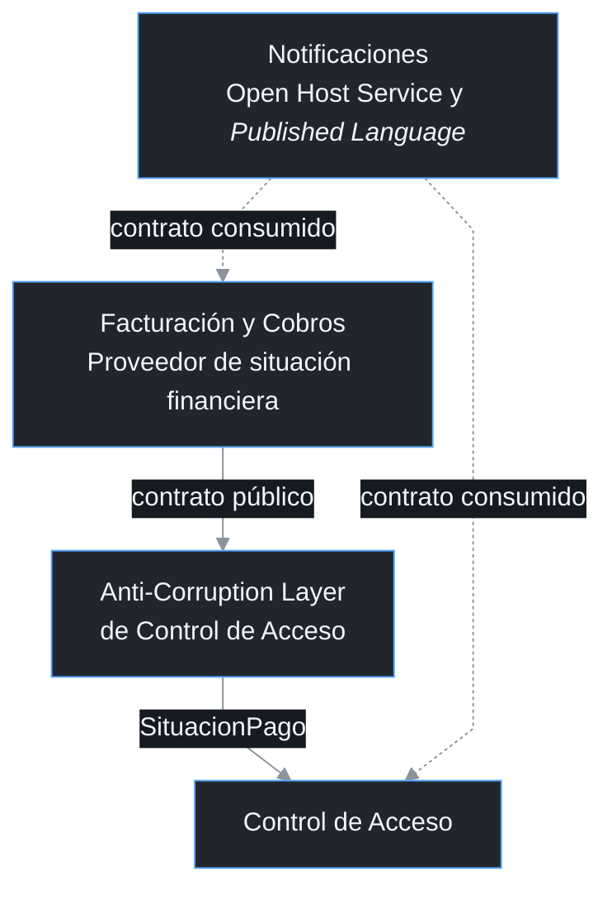
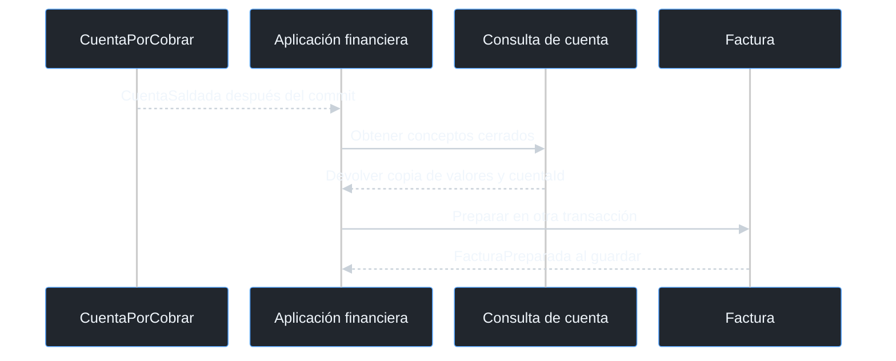
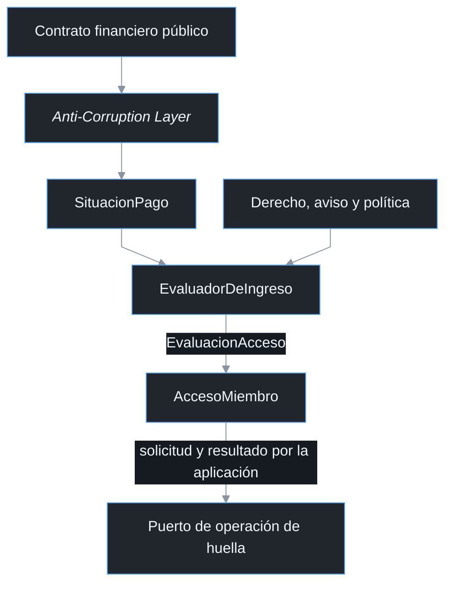

# Context Map y contratos

Consulta temática del [documento principal](00_ENTREGABLE_COMPLETO.md), con los diagramas, conceptos y reglas correspondientes.

### 5.2 *Context Map* general

Facturación y Cobros se relaciona con planes, reservas, precios y eventos mediante contratos que identifican al responsable de cada información. Control de Acceso utiliza los derechos y la situación económica para decidir sobre el ingreso. El proveedor de pagos, la emisión tributaria y el lector de huella se conectan mediante adaptadores, sin convertirse en nuevos subdominios. En las figuras 5.2a y 5.2b, planes, reservas y eventos se relacionan mediante *Customer/Supplier*; OHS y PL identifican *Open Host Service* y *Published Language* de Tarifas y precios. Las flechas van del proveedor del modelo al consumidor, y las discontinuas de la figura 5.2c muestran el contrato transversal de Notificaciones.

**Figura 5.2a. Proveedores de Facturación y Cobros.**

**Figura 5.2b. Proveedores de derechos de Control de Acceso.**

**Figura 5.2c. Contrato financiero y servicio transversal.**

### 5.3 Modelo interno de cada *Bounded Context*

**Figura 5.3a. Coordinación dentro de Facturación y Cobros.**

**Figura 5.3b. Traducción y decisión dentro de Control de Acceso.**

La cuenta y la factura son raíces distintas dentro de Facturación y Cobros. El evento de cuenta saldada provoca una consulta de los conceptos cerrados y permite preparar la factura sin compartir una instancia mutable de la cuenta. La *Anti-Corruption Layer* pertenece a Control de Acceso y convierte la respuesta pública en SituacionPago. AccesoMiembro utiliza ese valor para decidir, mientras el estado de Factura no se interpreta como sustituto de la confirmación del abono.

### 5.4 Responsabilidades y límites de integración

Cada raíz agrupa únicamente los datos que deben modificarse de forma consistente en una transacción. CuentaPorCobrar conserva saldo, aplicaciones y excesos, Factura mantiene sus líneas y estado fiscal, y AccesoMiembro conserva la operación y la evidencia física. Mantengo los planes, recursos y contrataciones fuera de estas raíces y los relaciono por identificador mediante sus contratos públicos. Una modificación de saldo no cambia el plan, la reserva ni el registro de huella.

| Subdominio responsable | Información entregada | Límite del intercambio |
| --- | --- | --- |
| Membresías y planes | Cuota, titular pagador, beneficiarios, vigencia y horario | Facturación no redefine derechos y Acceso no modifica el ciclo contratado |
| Reservas y disponibilidad | Consumo, cancelación cobrable, precio comprometido y derecho temporal | La disponibilidad, el solapamiento y la limpieza se resuelven antes del cargo |
| Agenda de eventos | Depósito, remanente, extras autorizados y derecho temporal | La aprobación y el aforo permanecen en el modelo del evento |
| Tarifas y precios | Cotización, descuento autorizado y versión | Una tarifa nueva no modifica conceptos ya liquidados |
| Espacios y recursos | Identidad y condiciones del recurso por su contratación | La cuenta referencia el servicio y no incorpora el inventario completo |
| Facturación y Cobros | Obligaciones, saldos, vencimientos y confirmaciones económicas | Acceso recibe SituacionPago mediante traducción y no consulta el repositorio financiero |
| Control de Acceso | Solicitudes, resultados de huella y evaluación de ingreso | El resultado físico no sustituye el abono ni cambia el total de Factura |
| Notificaciones | Resultado de envío y constancia correlacionada | El servicio entrega mensajes y no decide saldo o elegibilidad |

Un derecho temporal identifica sujeto, origen, intervalo y condiciones de contratación cumplidas. Su evaluación no requiere convertir al visitante en una membresía ni almacenar el aforo del evento en AccesoMiembro. Recepción puede realizar una apertura supervisada cuando el derecho confirmado lo permite. Los cambios económicos se tramitan en Facturación y Cobros y se comunican mediante el contrato correspondiente.

---

### 6.1 Gobierno de los contratos

La integración distingue quién controla el modelo y quién solicita una operación. Un proveedor puede definir el contrato aunque las peticiones viajen desde el consumidor hacia él. Esta diferencia es relevante en Notificaciones, que publica el servicio de entrega mientras Facturación y Cobros y Control de Acceso lo consumen. El sentido de una llamada HTTP no se utiliza como sustituto de la relación entre modelos.

| Relación | Proveedor del modelo | Consumidor | Patrón elegido y responsabilidad |
| --- | --- | --- | --- |
| Paquetes y derechos | Membresías y planes | Facturación y Cobros; Control de Acceso | *Customer/Supplier* con datos mínimos de cuota, pagador, vigencia y restricciones |
| Consumos y cancelaciones | Reservas y disponibilidad | Facturación y Cobros | *Customer/Supplier*; el consumo y su precio comprometido pertenecen a Reservas |
| Eventos y tramos | Agenda de eventos | Facturación y Cobros; Control de Acceso | *Customer/Supplier*; depósito, saldo, extras y derecho temporal identificados |
| Precios aplicables | Tarifas y precios | Facturación y Cobros y responsables de contratación | *Open Host Service* y *Published Language* para cotización versionada |
| Situación económica | Facturación y Cobros | Control de Acceso | *Anti-Corruption Layer* en el consumidor; ninguna entidad financiera compartida |
| Entrega de mensajes | Notificaciones | Facturación y Cobros; Control de Acceso | *Open Host Service* y *Published Language*; solicitud hacia Notificaciones y resultado inverso |
| Verificación externa | Servicio de pagos y registro de abonos | Facturación y Cobros | Adaptador y traducción de transacción externa a evidencia verificada |
| Emisión externa | Mecanismo tributario operado por Administración | Facturación y Cobros | Adaptador de captura y consulta de resultado; el documento interno sigue siendo Factura |
| Configuración de huella | Recepción y controlador de puerta | Control de Acceso | Puerto de actuación y resultado con adquisición previa de ejecutor |

Los contratos de los vecinos entregan hechos e importes que ya tienen un responsable de negocio. Facturación no necesita importar la entidad Reserva para registrar un alquiler, y Acceso no necesita cargar CuentaPorCobrar para evaluar el ingreso. Las traducciones se justifican por diferencias de significado y no por la mera existencia de una API. El modelo conserva sus reglas aunque un proveedor cambie la forma de entregar un mensaje o una constancia.
