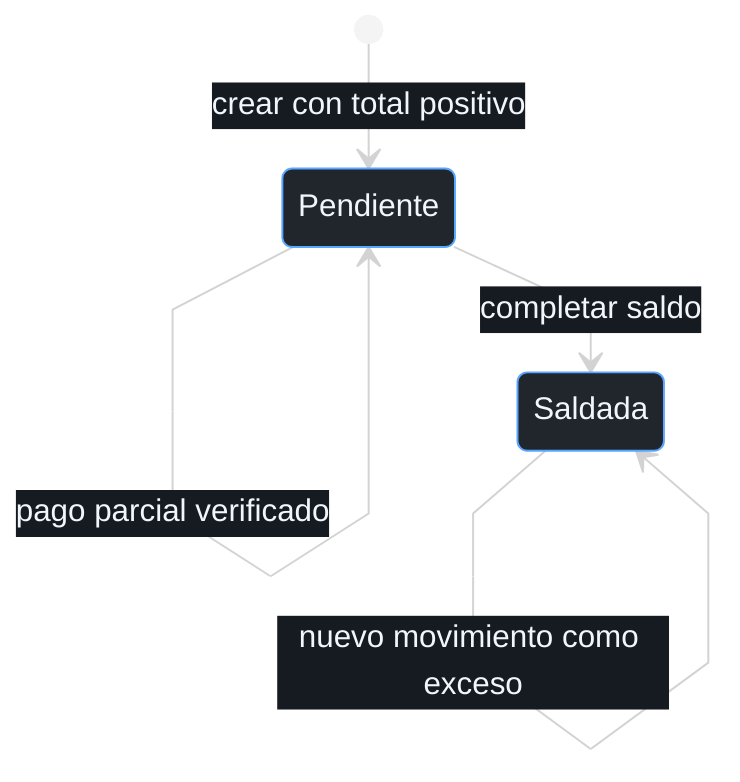
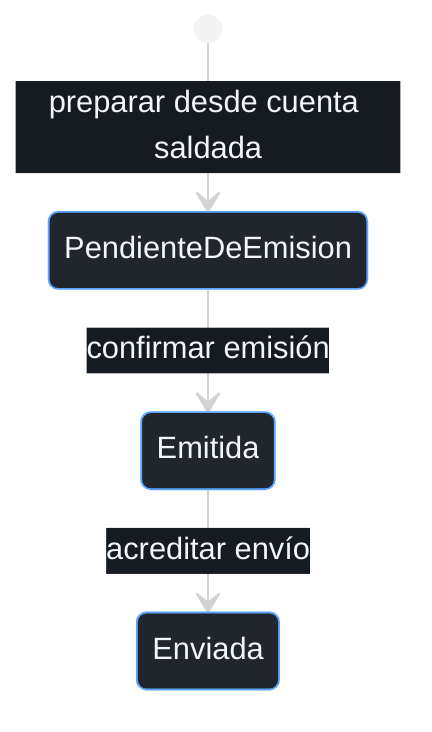

# Reglas e invariantes de las tres raíces

Consulta temática del [documento principal](00_ENTREGABLE_COMPLETO.md), con los diagramas, conceptos y reglas correspondientes.

### 7.3 Invariantes de CuentaPorCobrar

| ID | Invariante | Condición de aceptación | Rechazo o consecuencia |
| --- | --- | --- | --- |
| I01 | Total positivo y saldo entre cero y total | Conceptos válidos y total igual a suma de netos | No crear neto cero, negativo o monto manual inconsistente |
| I02 | Misma moneda en conceptos, pagos y devoluciones | Movimiento y cuenta tienen la misma moneda | No aplicar conversión implícita |
| I03 | Solo movimiento verificado reduce saldo | Transacción externa y abono interno conciliados; importe recibido positivo | Comprobante aislado no modifica la obligación |
| I04 | Referencia aplicada una vez con datos originales | Repetición idéntica devuelve YaAplicado | Mismo origen y referencia con monto o cuenta distintos es conflicto |
| I05 | Pendiente equivale a saldo positivo; Saldada equivale a cero | Aplicación limitada al saldo restante | El exceso no vuelve negativo el saldo |
| I06 | Aplicaciones, excesos y eventos se guardan juntos | Movimiento nuevo aceptado en transacción local | Fallo de guardado no publica éxito |

Dinero utiliza precisión decimal fija y la escala definida para su moneda; las operaciones no emplean números binarios aproximados. El neto de cada concepto llega con el redondeo autorizado y el total suma esos netos sin recalcular el precio. Un descuento no puede superar el importe bruto ni producir un concepto negativo. La asociación de origen y referencia con una cuenta se protege además mediante unicidad transaccional del módulo. Una raíz aislada no conoce las aplicaciones guardadas en otra cuenta. Por eso el registro de la asociación y el guardado de la raíz ocurren en la misma transacción financiera. Un conflicto de concurrencia obliga a recargar antes de decidir si la entrega es repetida o incompatible.

### 7.4 Estados y operaciones económicas

La cuenta utiliza Pendiente y Saldada como estados económicos. Un pago parcial conserva Pendiente y reduce el saldo únicamente por el importe verificado. Un movimiento superior al saldo aplica la parte necesaria y registra el resto como ExcesoPago asociado a una DevolucionExceso. Un nuevo movimiento real después de saldar no se descarta como duplicado: queda completamente identificado como exceso, sin segunda transición a Saldada.

**Figura 7.4. Estados de CuentaPorCobrar.**



| Estado | Operación | Guarda y resultado económico | Evento o auditoría |
| --- | --- | --- | --- |
| No existe | crearCuenta | Conceptos liquidados, identidad única, total positivo y moneda coherente | CuentaPorCobrarCreada |
| Pendiente | registrarPagoConfirmado | Verificación confiable; aplicar mínimo entre recibido y saldo | PagoRegistrado; CuentaSaldada solo si llega por primera vez a cero |
| Saldada | registrarPagoConfirmado con referencia nueva | Aplicación cero; conservar recibido como exceso | PagoRegistrado y ExcesoPagoIdentificado; no otra CuentaSaldada |
| Cualquiera | registrarPagoConfirmado con referencia idéntica | Comprobar datos originales antes de comparar con saldo actual | YaAplicado, sin eventos nuevos |
| Cualquiera | aprobarDevolucion | Exceso real verificado y autorización de Dirección | Aprobación registrada en entidad interna |
| Cualquiera | adquirirDevolucion | Estado aprobado y un único responsable de ejecución | EnProceso, guardado antes de enviar la devolución |
| Cualquiera | registrarNoEjecucionDevolucion | No salida, ausencia de instrucción en curso y cese reconocidos | Devuelve entidad a Aprobada para otra adquisición; conserva intento cerrado |
| Cualquiera | confirmarDevolucion | Referencia y abono de salida verificados; importe no mayor al exceso | DevolucionConfirmada; la cuenta no se reabre |

### 7.7 Factura como parte del modelo financiero

La liquidación mensual establece lo que debe pagarse y puede existir antes de recibir dinero. Factura se prepara cuando la cuenta correspondiente queda saldada mediante movimientos verificados y los datos de facturación están completos. Esta separación permite cobrar cuotas y consumos del mes y, posteriormente, emitir el comprobante que documenta lo cobrado. Las operaciones anticipadas y los depósitos siguen el mismo procedimiento sobre su propia cuenta, con el detalle del tramo contratado.

| ID | Invariante de Factura | Garantía |
| --- | --- | --- |
| I13 | Total igual a suma de LineaFactura y al total aplicado de la cuenta saldada | No facturar el exceso ni omitir conceptos cobrados |
| I14 | Una factura ordinaria por cuenta y tipo de documento | Reentrega de CuentaSaldada no crea otro comprobante |
| I15 | Emitida exige referencia fiscal y resultado externo verificado | Solicitar emisión no equivale a emitir |
| I16 | Líneas emitidas inmutables y envío independiente | Cambio de tarifa o reenvío no modifica el documento |

**Figura 7.7. Estados de Factura.**



| Operación de Factura | Entrada y guarda | Cambio permitido | Respuesta ante problema |
| --- | --- | --- | --- |
| prepararFactura | Cuenta saldada, conceptos cerrados, datos fiscales y clave de cuenta/documento no usada | Crear líneas, total y PendienteDeEmision | Cuenta aún pendiente o datos incompletos impiden preparar |
| adquirirEmision | PendienteDeEmision sin ejecución activa | Asignar intento y responsable antes de operar el portal | Otro ejecutor no recibe autorización |
| registrarNoEmision | Evidencia de ausencia de emisión, instrucción no vigente y cese reconocido | Cerrar intento sin efecto, conservar PendienteDeEmision | No se vuelve a adquirir por mera expiración |
| confirmarEmision | Resultado de la emisión adquirida, referencia y total coincidentes | Emitida y FacturaEmitida | Incertidumbre conserva pendiente y exige consulta externa |
| registrarFalloEnvio | Emisión existente y resultado de envío fallido | Conservar el estado previo, Emitida o Enviada, y el detalle del intento | No volver a emitir factura |
| confirmarEnvio | Constancia de envío del documento correcto | Enviada y FacturaEnviada | Mensaje ajeno o referencia distinta se rechazan |

```text
Factura.preparar(cuentaSaldada, datosFacturacion, identidadDocumento):
  exigir saldo = 0 y total aplicado a conceptos = total de cuenta
  copiar LineaFactura y condiciones economicas cerradas
  exigir total = suma de lineas y moneda coherente
  crear PendienteDeEmision y registrar FacturaPreparada

adquirirEmision(ejecutorId, ahora):
  exigir PendienteDeEmision y ningun intento activo o incierto
  crear IntentoEmision con responsable unico
  devolver permiso provisional, valido solo despues de guardar y confirmar

registrarNoEmision(evidencia, ahora):
  exigir no documento emitido, no instruccion vigente y cese reconocido
  cerrar intento sin efecto; conservar PendienteDeEmision

registrarResultadoInciertoEmision(intentoId, ahora):
  exigir intento adquirido sin resultado terminal
  conservar intento y responsable; mantener PendienteDeEmision

confirmarEmision(resultado, ahora):
  si mismo resultado ya confirmado: devolver SinEfecto
  exigir intento adquirido, referencia fiscal verificable e importes coincidentes
  conservar ResultadoEmision y pasar a Emitida
  registrar FacturaEmitida

confirmarEnvio(constancia, ahora):
  exigir documento Emitida o Enviada y constancia correspondiente
  si envio identico ya registrado: devolver SinEfecto
  conservar constancia y pasar a Enviada
  registrar FacturaEnviada
```

La creación de Factura no contiene una llamada al proveedor de pagos ni al portal de emisión. La aplicación reúne la cuenta saldada y la evidencia, y la raíz valida que el documento interno pueda nacer. Administración actúa como responsable de emisión y registra el resultado externo de su intento adquirido. Si la respuesta se pierde, primero consulta la referencia del documento para evitar emitir otro comprobante por la misma cuenta.

### 8.2 Invariantes y política temporal

| ID | Invariante | Ejemplo o rechazo |
| --- | --- | --- |
| I07 | La suspensión por impago solo se solicita desde Habilitado cuando existe obligación bloqueante vencida, plazo de cinco días y aviso de veinticuatro horas cumplidos | Antes del quinto día, aviso insuficiente, alcance incompleto o ausencia de deuda vencida fuera de tolerancia rechazan |
| I08 | Suspendido exige evidencia válida de registro de huella dado de baja/ausente: confirmación ordinaria, retiro correctivo o reconciliación física expresa | Orden enviada, *timeout* o alta fallida no acreditan retiro; la corrección exige otra operación identificada |
| I09 | Solicitar alta ordinaria exige Suspendido, obligaciones exigibles regularizadas, plan vigente y permiso explícito; habilitar exige alta observada y reevaluación de rehabilitación favorable | Pago sin vigencia rechaza; resultado incierto nunca habilita |
| I10 | Como máximo una operación no terminal por acceso; solo un ejecutor/intento adquirido y persistido puede actuar | Dos ejecutores de la misma versión no reciben ambos autorización |
| I11 | Reintentar reutiliza operacionId con intento nuevo y evaluación reciente; terminales idénticos no mutan ni reemiten eventos | No reenviar tras *timeout*, no liberar por mero vencimiento de un bloqueo |
| I12 | Referencias externas por ID y ausencia de biometría en dominio, ejemplos y eventos | Evidencia no contiene plantilla o foto de huella |

Mantengo una tolerancia de cinco días calendario desde el vencimiento de cada obligación que puede bloquear el derecho de acceso. Defino además un aviso exitoso con al menos veinticuatro horas de anticipación. La fecha efectiva de corte es el máximo entre vencimiento más cinco días y envío acreditado más veinticuatro horas. Esta regla permite avisar tarde sin retrofechar el mensaje ni ejecutar una suspensión que carezca del margen previo.

| Dato o situación | Regla operativa | Resultado |
| --- | --- | --- |
| Obligación vence el 1 de noviembre a las 09:00 | Límite económico: 6 de noviembre a las 09:00, America/La_Paz | Antes del límite no se solicita suspensión por esa obligación |
| Aviso enviado el 2 de noviembre a las 10:00 | Margen de aviso termina el 3 de noviembre a las 10:00 | Corte posible desde el 6 de noviembre a las 09:00 si persiste deuda |
| Aviso enviado el 6 de noviembre a las 12:00 | El margen termina el 7 de noviembre a las 12:00 | El corte espera hasta ese instante |
| Plan de horario normal | Lunes a viernes, intervalo 08:00 a 18:00, fin excluido | Un intento a las 18:00 queda fuera de horario |
| Plan con acceso continuo | Todos los días, dentro de la vigencia contratada | El horario no restringe, pero deuda y vigencia siguen evaluándose |
| Pago y alta a las 20:00 | Se permite configurar si corresponde rehabilitar | El intento de ingreso depende del horario del plan |

Para el horario normal establezco como configuración de operación la franja de lunes a viernes de 08:00 a 18:00, en America/La_Paz. Cada derecho conserva el horario y la versión que le corresponden, por lo que un plan continuo no hereda esa restricción. Rehabilitar el registro e ingresar son acciones distintas. Administración solicita la rehabilitación con obligaciones exigibles regularizadas y derecho vigente, bajo la política de Dirección. Cada entrada agrega la restricción horaria y la ausencia de incidencias que impidan confiar en el estado. El adaptador de apertura debe aplicar esa evaluación; configurar una huella no puede presentarse como autorización de ingreso fuera del horario contratado.
